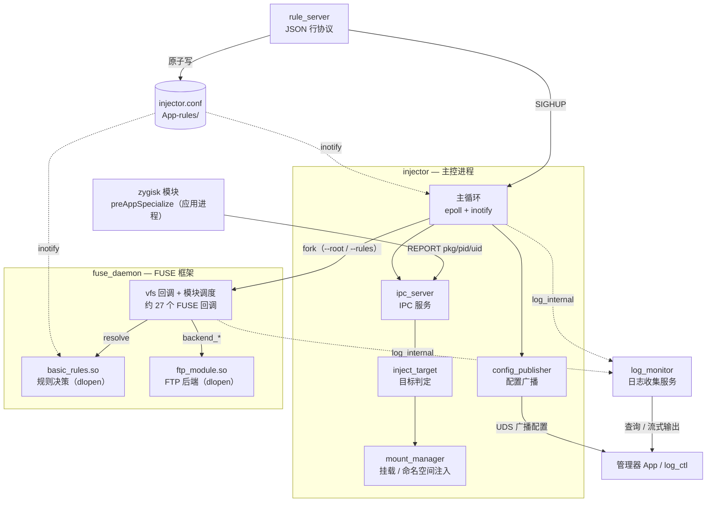

# 总体设计

面向维护者的架构说明：模块边界、进程协作与数据流。

## 1. 项目定位

Fuse-Proxy 运行在 **Android 13+（API 33~35）**，作为 root 模块的二进制核心组件，通过两项内核机制实现**应用粒度**的存储访问控制：

- **FUSE 用户态文件系统**：拦截应用对外部存储（`/sdcard`、`/storage/emulated/N`）的文件操作，按规则透明改写。底层真实物理存储固定为 `/data/media/<user_id>`（`STORAGE_BASE`），所有重定向最终归一到此。
- **挂载命名空间隔离**：检测 zygote 子进程，将定制的 FUSE 挂载注入目标应用的 mount namespace，规则只对目标应用生效。

核心能力：存储重定向（REDIRECT/ALLOW）、路径隐藏（HIDE，含跨应用隔离）、只读保护（RO）、沙箱隔离（SANDBOX）、命名空间注入、专属媒体 FUSE（为 `com.android.providers.media.module` 单独起实例，惰性启停）、配置广播（UDS 实时发布配置供管理器 App 消费）。规则语法见 `config.md`。

## 2. 进程架构

6 个可执行文件各自为独立进程，经 Unix Domain Socket 协作：



> 除 zygisk 通知外，injector 也可经周期扫描 `/proc` 主动发现应用；两条途径的关系见 §5.1。

> injector 同时维护**两棵** FUSE 树——全局 FUSE（`inject_global_fuse`，挂载于 `/mnt/nsp_global`）与媒体模块专属 FUSE（`inject_media_fuse`，惰性）。二者共用同一 `fuse_daemon` 二进制与 `--rules` 配置，挂载点不同。

### 2.1 injector — 主控

系统级守护，发现目标应用并为其注入 FUSE 挂载。

- **事件循环**：`epoll` 统一管理 inotify（配置变更）、IPC socket、异步挂载完成管道、FUSE ready 管道、定时器（周期扫描）。
- **目标判定**（`inject_target.c`）：包名匹配配置、系统应用过滤、隔离进程过滤。
- **挂载注入**（`mount_manager.c` + `ns_utils.c`）：进入目标进程 mount namespace，挂载 FUSE 并做 bind mount 恢复。
- **IPC / 广播**（`ipc_server.c` / `config_publisher.c`）：接收查询控制命令；以 JSON 经 UDS 发布配置（GET / STATIC / SUBSCRIBE）。STATIC 的 `global`/`apps` 段**复用 config_parser 已加载的 AppConfig 快照**（解析后的视图：路径已归一、内部 `?` 前缀已剥离、规则按确定性顺序排序，含类别段与 App-rules 分文件），不再对 `injector.conf` 做 `sscanf` 旁路重解析，也不触发 `load_config_rules`（那会替换 injector 的 live 配置）；`app_rules` 段仍回显磁盘上 `App-rules*/*.conf` 的**原始文件内容**。

### 2.2 fuse_daemon — FUSE 守护

由 injector 以 `--mode=redirect --root=/data/media --rules=<injector.conf>` 启动，实现约 27 个 `fuse_operations` 回调。框架**零规则功能**：

- **规则决策**经 `module_dispatch_resolve` 分派给 dlopen 的 `basic_rules.so`，无规则模块时直通回退。
- **后端分派**（`NSP_CAP_BACKEND_IO`）：resolve 命中 FTP 规则（`rr.is_ftp`）时经 `module_backend_lookup` 定位后端模块并改调其 `backend_*` 方法；未命中则本地直通（`module_backend_active()` 快速路径零开销）。
- **uid→包名解析**（模块内 `br_get_pkg`）：uid<10000 判为 `system`；否则查 `uid.map` → 读 `/proc/<tid>/status` 的 `Tgid` + `cmdline`。解析出 `<pre-`/`zygote`/长度<3 的视为不可解析，缓存为 nullptr。

模块架构详见 `modules.md`。

### 2.3 日志子系统

- **log_monitor**：常驻收集服务，经 AF_UNIX `SOCK_STREAM`（抽象地址 `nsp_log_socket`）接收各进程 `log_internal`，并提供 `search`/`stream`/`clear`/`count` 查询。io/sys 自动落盘 `LOG_DIR/io.log`、`sys.log`（`push_log` 单漏斗暂存 64KB，stage 满 / 500ms tick 脏超 1s / 退出时刷盘；单文件超 2MB 轮转 `.1` 单备份，logcat 不落盘）。启动时把落盘文件载入只读独立缓冲（每类上限 2048 条），查询按"磁盘在前、内存在后"拼接。
- **log_ctl**：CLI 客户端——查询日志、流式输出、规则编辑（`set-rule`/`remove-rule`/`validate-rules`）、拉取配置广播（`get-config`/`stream-config`）。规则编辑与 `rule_server` 共用 `nsp_rule_file` 行级实现（原子 tmp+rename 落盘）；`--config-dir` 可覆盖配置根（与 `rule_server` 同名选项一致），使其可在临时目录下测试。
- **LOG_BATCH 协议**：应用还原等"一条日志对应整个挂载周期"的场景，周期内中间日志由 `log_batch_begin/end` 在 `log_internal` 层累积，`log_batch_end` 合并为**单条**（`LOG_KIND_MERGED`）发送。合并日志为单行 `[injector] <条目1>\t<条目2>...`（制表符连接，避免前端按行拆分导致 UTF-8 截断），级别固定 `LOG_DEBUG`。

## 3. 源码布局

```
src/
├── core/                 # 跨进程共享基础设施
│   ├── common.c          # 日志、路径消毒、IPC 收发、时区、cgroup 逃逸、存储路径合成
│   ├── nsp_util.c        # 纯 libc 公共库（UDS 地址、send_all、trim、mkdir_p、daemonize）
│   ├── nsp_comm.c        # 统一通讯线程（全进程唯一发后即忘出口）
│   ├── nsp_ini_store.c   # 通用 INI 段式存储（rule_server 私有静态库，非模块 ABI）
│   ├── nsp_rule_file.c   # 规则文件行级读写（rule_server 与 log_ctl 共享，原子落盘）
│   ├── path_trie.c       # 路径 Trie（零业务依赖，可独立单测）
│   ├── uid_map.c         # uid→包名映射（磁盘持久化 + 内存缓存）
│   ├── sys_pkg.c         # 系统应用包名缓存（pm list packages -s）
│   ├── fast_pid.c        # PID/进程信息快速读取
│   ├── fast_search.c     # NEON 优化子串检索（mountinfo 匹配）
│   ├── sha256*.c         # 模块 ban 记录哈希（含硬件加速）
│   ├── crash_dump.c      # 崩溃转储
│   └── build_info.c      # 编译期版本/git 哈希
├── config/
│   ├── config_parser.c   # 规则解析、AppConfig 管理、Trie 构建、变量静态性分析
│   └── path_vars.c       # 路径变量展开、真实目标分类
├── daemon/
│   ├── fuse_daemon.c     # FUSE 回调 + main（框架，含后端分派）
│   └── fuse_thread_naming.c  # 线程语义命名（pthread_create 截持）
├── module/               # 模块框架
│   ├── loader.c          # dlopen 加载/卸载、能力登记、分派、inotify 热插拔
│   ├── fault_fence.c     # 调用围栏（sigsetjmp 崩溃恢复）
│   └── module_guard.c    # 输出校验 + 熔断器
├── modules/              # 热插拔模块（.so）
│   ├── basic_rules/      # 规则引擎：REDIRECT/SANDBOX/HIDE/ALLOW/RO
│   └── ftp/              # FTP 存储后端（纯方法模块，无 FUSE 实现）
│       ├── ftp_mux.c     #   控制面 epoll + curl_multi 复用器（连接复用/并发）
│       └── ftp_backend_libcurl.c  #   路径映射 + 读写（数据面每文件独立句柄）
├── injector/             # 注入器（injector/inject_target/mount_manager/
│   │                     #   ns_utils/ns_global_replace/ipc_server/config_publisher）
│   └── global_replace_ctl.c  # 全局替换挂载测试驱动（仅 GNU）
├── zygisk/               # Zygisk 应用创建通知模块（仅 Android，双 ABI）
│   ├── zygisk.hpp        # Zygisk ABI 头（ISC，取自 Magisk，原样收录）
│   └── zygisk_module.cpp # preAppSpecialize 上报 → companion → injector
├── rule/rule_server.c    # 规则控制服务（JSON 行协议）
└── log/                  # log_monitor、log_ctl
```

外部依赖：`libfuse3`（**仅 fuse_daemon 直接用**，规则/后端模块均不链接）、`json-c`（配置广播/日志 JSON）、`libcurl`（仅 ftp_module，≥8.21.0）、`iconv`、`pthread`。C23 标准，`warning_level=3`，Release `-O3 -flto`。产物与源文件映射见 `meson.build`。

## 4. 规则系统

由 `config_parser.c`（解析与存储，编译进各进程）+ `basic_rules.so`（匹配与应用，dlopen 进 fuse_daemon）组成。规则语法与作用域见 `config.md`。

### 4.1 双通道存储：Trie + 线性数组

按是否含通配符/变量分两条通道，是性能与灵活性的权衡：

- **纯静态规则**（无 `*?[]`、无 `$`）→ **Trie**（多叉前缀树，按 `/` 分段）。单次查询 O(路径段数)，且一次 `trie_lookup_full` 同时返回 hidden/ro/redirect/ftp 四类命中。绝大多数规则走此快路径。
- **含通配/变量的规则** → 线性数组（`hide_rules[]`/`ro_rules[]`/`redir_rules[]`），逐条 `fnmatch` + 前缀匹配。数量通常很少。

### 4.2 单次操作的热路径

```
FUSE 回调（如 getattr）
  └─ VFS_SETUP_CORE 宏：经 module_dispatch_resolve 一次调用取回全部决策
       ① br_get_app_cfg(uid) ──────────── uid→AppConfig（2048 槽 seqlock 无锁读缓存，O(1)）
       ② br_sanitize_and_check_hidden ─── 路径消毒 + Trie 一次性解析（填 TrieMatch）+ 隐藏判定
       ③ br_to_real_path ──────────────── 复用 TrieMatch 的 redirect 结果 → 真实路径
  └─ 写操作额外：br_is_path_ro ────────── 复用 TrieMatch 的 ro 结果
```

`TrieMatch` 缓存使单次操作对两棵 Trie（app + global）的遍历从 6 次降到 2 次。上述整段在 `config_read_begin()`/`config_read_end()` 无锁快照内完成（见 §6）：持槽期间配置不会被替换，`config_read_end` 返回 false 时整个 resolve 重试。

### 4.3 真实路径解析优先级

`br_to_real_path` 按序解析：

1. **Trie 静态 redirect 命中**（复用 `TrieMatch`）：目标以 `?` 开头则转 `STORAGE_BASE/<user_id><后缀>`。
2. **线性 redir_rules**：app 优先、global 兜底；目标经 `build_real_base_from_target` 分类（分类表见 `config.md` §4）。
3. **sandbox 重定向**：`SANDBOX ON` 时，除应用自身 `/Android/data|obb/<pkg>` 外的访问重定向到 `/Android/data/<pkg>/sandbox`。
4. **fallback**：`STORAGE_BASE/<user_id><sub_path>`。

> `?` 前缀是内部标记，由 parse 阶段对 ALLOW 和相对路径 REDIRECT 自动生成，表示"相对当前用户存储"。

### 4.4 跨应用隔离

`br_is_other_app_pkg` 判定应用访问 `/Android/data|obb/<其他包>/`。隔离**只作用于列举**——readdir 条目级 probe 过滤；resolve（getattr/open）**不判隐藏**，已知路径的文件可正常打开（修复 MT 管理器跨应用列表可见但打开 ENOENT）。该标志只存在于 `NspProbeResult`（`is_other_app_pkg`），`NspPathDecision` 不携带。`CONFIG_DIR` 下所有访问无条件隐藏。

### 4.5 决策强制（框架单点）

模块只声明「路径该怎么表现」（`NspPathDecision`），**errno 映射与权限策略不由模块决定**，集中在框架：

- `fw_route()`（`fuse_daemon.c`）是所有回调的唯一入口，按操作类别 `VFS_OP_READ` / `VFS_OP_MUTATE` 强制：`appear_missing` → `ENOENT`（**所有**回调统一，写类不再是 `EACCES`）、`read_only` → `EROFS`（root 豁免由框架持有）。`open`/`access` 是否算「写」取决于 `flags`/`mask`（`O_RDONLY` 打开只读路径必须放行），触发条件留在回调内，但判定统一走 `vfs_check_read_only()`。
- `vfs_apply_attr_override()` 在框架既有属性来源**之后**落实 `attr_override`（`NSP_OV_MODE/UID/GID` 位图），故模块的显式声明优先于框架默认（底层真实属性、虚拟目录继承上级目录、FTP 条目继承用户存储根）；`mode` 只取 `07777`，类型位始终取自真实属性。
- **属性一律原样上报底层真实值**：早期的「默认伪造模式」（属主改写为访问者、重定向目录强制 0777、skel 目录强制 0755）连同 `--preserve-perms` 开关已删除。理由：挂载只带 `allow_other` 而无 `default_permissions`，内核对 `open/read/write` 本就不做 DAC 判定（仅 `access(2)` 下发 `FUSE_ACCESS`，且由 root 守护进程执行的 `access()` 必然通过），模块也不具备 POSIX DAC——伪造属主拦不住任何访问，只会误导读取方。`readdir` 的 filler 只消费 `st_ino` 与类型位（`fuse_add_direntry` 不读 uid/gid），故条目侧的属主赋值同样是死代码。

> 位图而非「特殊值哨兵」：若用 `mode == UNSET` 表示不改，模块惯用的 `memset(out,0,...)` 会静默变成「权限清 0 + 属主 root」。位图让零初始化等于「什么都不改」。

收敛前，`hidden`/`ro` 判定散落在 27 个回调里各写一遍（写类还各自映射 `EACCES`），新增回调极易漂移。回归见 `tests/test_module_overrides.py`（逐回调 errno 矩阵）。

## 5. 进程协作

### 5.1 注入流程

1. injector 启动先 `inject_global_fuse` 挂载全局 FUSE；若 `com.android.providers.media.module` 在目标之列，惰性起媒体专属实例。
2. 经 zygote 子进程检测（`fast_pid` + `/proc` 扫描，timerfd 驱动）发现新启动应用。
3. `inject_target` 判定是否为目标（含 `SKIP_SYSTEM_APPS` 过滤、隔离进程过滤）。
4. 命中则 `mount_manager` + `ns_utils` 进入其 mount namespace 挂载 FUSE。
5. 此后该应用对 `/sdcard` 的访问经 FUSE → basic_rules 匹配。

#### 主动扫描与被动通知

第 2 步有两条并存的途径。除周期扫描外，Zygisk 模块（`src/zygisk/`）在应用创建时即时上报：

```
app 进程  preAppSpecialize ──→ connectCompanion ──→ "REQ <pkg> <pid> <uid>"
companion（root）           ──→ nsp_ipc_socket   ──→ "REPORT <pkg> <pid> <uid>"
injector  ipc_server.c 解析 ──→ 置 g_passive_mode，转入被动模式
```

injector 收到**首次**通知即置 `g_passive_mode` 并永久停止周期扫描（`maybe_periodic_scan`），此后新应用的发现完全依赖该模块——通知比轮询及时，也免去了持续扫描 `/proc` 的开销。

因此 Zygisk 模块**必须 64/32 位双 ABI 部署**：只装 64 位时，任一 64 位应用触发被动模式后，跑在 32 位 zygote 上的应用既收不到通知、也等不到扫描，将彻底漏注入。打包脚本对两个 ABI 都有存在性断言。


### 5.2 配置热重载

- injector 用 inotify 监听 `injector.conf` 与 `App-rules*/*.conf`。
- fuse_daemon 框架侧（`src/daemon/fw_config.c`）**唯一负责**读取与解析规则配置：单个 `config_monitor_thread` 监听规则目录，变更后经 `config_read_view()` 重新解析为扁平视图、原子换入并递增代际，再**按各模块在 `init` 内的订阅**（`api->subscribe_rules`）过滤后回调其监听器（`api->set_config_listener`）。模块不再各自读文件、各自跑 inotify——同一份配置在进程内只有一份实例（`basic_rules` 用下发的视图经 `config_build_from_view()` 重建自己的 AppConfig/Trie/uid 缓存）。
- injector 经 `config_publisher` 向订阅者广播；`global_inject` 切换则广播全量变更（`changed_count=-1`）触发全应用重挂，否则仅通知受影响包。

### 5.3 路径缓存失效（内核侧）

两层语义互补，框架收口在 `vfs_inval_path()`（`fuse_daemon.c`）：

- **inode 级** `fuse_invalidate_path()`：丢属性/数据缓存，对已打开的文件立即生效（句柄直接持 inode，不再经名字查找）。
- **entry 级** `fuse_invalidate_path_entry()`：丢内核 dentry，使「名字 → inode」重新 lookup。远端增删/改名后**只有它**能让旧映射立即失效——inode 级不触碰名字映射，旧 dentry 会一直命中到 `entry_timeout` 到期。

entry 级是项目内 libfuse fork 的追加接口（`subprojects/libfuse`，导出版本节点 `FUSE_3.19`），上游/系统/预构建库都没有，故框架侧**弱引用**：符号缺失时自动退化为仅 inode 级。负缓存另由框架把 `negative_timeout` 保持为 libfuse 默认的 `0.0` 关闭（早期版本曾抬到 0.5，导致 FTP「上传后立即 open」命中陈旧 ENOENT）。行为回归见 `tests/test_libfuse_inval.py`。

### 5.4 UDS 一览

| Socket | 类型 | 用途 |
|--------|------|------|
| `nsp_ipc_socket` | 抽象 | injector 控制/查询（如 `list-injected`、`LIST_MODULES`） |
| `nsp_config_broadcast` | DGRAM 抽象 | 配置广播（GET/STATIC/SUBSCRIBE） |
| `nsp_log_socket` | SOCK_STREAM 抽象 | 各进程 `log_internal` → log_monitor；log_ctl 查询同走此路 |

## 6. 全局状态与并发

| 全局 | 归属 | 保护 |
|------|------|------|
| `g_global_cfg` / `g_app_cfgs` | config_parser | S1 无锁快照（代际 + per-thread 读者计数）；冷路径查询与写者仍走 `g_rules_lock` rwlock |
| `g_uid_maps` / `g_uid_map_count` | basic_rules | 同一 S1 代际协议（COW + `config_publish_begin/drain_readers/publish_end` 后换指针），二分查询 |
| `g_uid_cache[2048]` | basic_rules | seqlock（写者 wlock+seq 翻转，读者无锁），slot = `uid % 2048`，带配置代际校验 |
| `g_recs` / `g_subs` / `g_gen` | fuse_daemon `fw_config` | 单一 `g_lock` 互斥 + 原子代际；发布路径「读锁内换视图 + 递增两槽引用计数 → 锁外回调模块」，故模块卸载的 drain 会等回调结束 |
| `g_global_fuse` / `g_media_fuse` | injector | 各自字段（pid/mnt_path/disabled/crash_count） |

FUSE 回调多线程并发执行。热路径（`br_resolve`/`br_probe`）**不取 rwlock**：`config_read_begin()` 持槽返回稳定代际，`config_read_end(gen)` 返回 false（读期间发生发布）则整个 resolve 重试；持槽期间旧配置不会被释放。写者 `config_publish_begin()` 置奇数封锁新读者 → `config_drain_readers()` 等旧代际归零 → 非原子交换 → `config_publish_end()` 放行并再等旧槽归零，之后才释放旧配置。读者计数按代际奇偶分槽、每线程独占 64B 缓存行，并发读不产生缓存行颠簸。**冷路径**（`config_publisher`/`log_ctl` 查询）仍走 `config_lock_read()` rwlock；框架层不再统一加读锁，`VFS_RETURN` 只是普通返回。

## 7. 维护规范

- **公共工具归属**：①纯 libc、无全局依赖 → `src/core/nsp_util.c`（UDS 地址填充、`nsp_send_all`、`nsp_str_trim`、`nsp_mkdir_p`、`nsp_daemonize`、`nsp_escape_cgroup`），各二进制与**树内** dlopen 模块均可链接，**禁止私刻副本**；②依赖项目全局（`g_real_root`、日志、SELinux）→ `src/core/common.c`（模块侧经 `nsp_module.h` 导出表解析）。注意：`nsp_util` 是树内共享实现，**不是模块 SDK 的公开 ABI**——第三方模块要保留 ABI 链接例外，只能依赖 `nsp_module.h`（及其代含的公开头），不得 include `nsp_util.h` 或编入项目源码。
- **存储路径合成唯一出口**：禁止裸拼 `STORAGE_BASE "/%d…"`——默认真实路径走 `common_default_real_path()`、用户存储根走 `common_storage_root()`、沙盒目标走 `common_sandbox_path()`。`MAX_PATH_LEN` 放不下时返回 -1，调用方**放弃重定向而非截断**（sandbox 尤其注意：`current_pkg` 可能极长）。
- **函数命名前缀**：`br_*`（基础规则）、`config_*`、`module_*`/`nsp_guard_*`/`nsp_fence_*`（模块框架）、`ftp_*`、`trie_*`、`sha256_*`/`uid_map_*`/`fast_pid_*`、`vfs_*`/`fw_*`（FUSE 回调）、`ns_*`（mount namespace）、`nsp_*`（轻量公共库）、`common_*`（路径合成）。新增跨文件函数必须带域前缀；`inject_target.c` 的 `is_*/add_*` 裸名是已知历史包袱。
- **头文件职责**：`mkdir_recursive_p`、`is_media_provider` 的权威声明只在 `common.h`（`config_parser.h` 不得重复）；`_locked` 后缀函数不得进公共头。`LogLevel`/`log_internal` 与日志宏的权威只在 `nsp_log.h`（`common.h` 代含），跨进程/跨模块业务常量（`NSP_CONFIG_DIR`/`NSP_STORAGE_BASE`/uid 布局/行缓冲上限）的权威只在 `nsp_constants.h`——`common.h` 的 `CONFIG_DIR`/`STORAGE_BASE`/`LOG_DIR` 与 `nsp_module.h` 的同名别名均以它为唯一出处。`crash_dump.c` 的 `backtrace/backtrace_symbols*` 是**故意**的静态实现（满足 `libfuse3.a` 对 `execinfo.h` 的链接依赖），不得改名。
- **初始化契约**：`log_init` 内部调用 `init_timezone`；仅 `log_monitor`（自身即日志服务端，不走 `log_init`）直接调，其余进程不得手动补调。
- **统一通讯线程**：所有发后即忘 socket 发送经 `nsp_comm_post(ch, data, len)`（`nsp_comm.h`，全进程唯一入口），调用线程永不阻塞、永不碰 socket。`LOG`/`IPC` 后端常驻 `log_init`；`BCAST` 由 injector、log_monitor 各自注册。同步 query 类（`LIST/COUNT/QUERY`）与 `log_ctl` 短命 CLI 保持阻塞原样。背压：满环覆盖最旧 + `dropped` 计数；drain 优先级 `IPC > LOG > BCAST`。
- **fd 归属铁律**：谁拥有集合，谁 `close`。comm 线程拥有的客户端 fd，主线程只允许 `shutdown` + 投递控制消息，**禁止直接 `close`**（不断号，杜绝复用竞态）；退出时先 `nsp_comm_fini()` 再集中关闭。
- **规则文件编辑唯一实现**：`rule_server` 与 `log_ctl` 的规则行级读写统一走 `nsp_rule_file`（`src/core/nsp_rule_file.c`，纯 libc）——段式文件（`injector.conf`）与无段文件（`App-rules/<pkg>.conf`）的开关替换、规则去重、按 `(类型, 索引)` 删除均只有一份实现，落盘一律 tmp+rename 原子写（inotify 端不会读到半截文件）。索引语义以 `rule_server` 为准：**计入 `#` 停用的行**，与 LIST 输出一致。
- **模块 resolve 输出逐字段初始化**：`module_dispatch_resolve` 对未命中/空查询/根路径也调用 `nsp_resolve_result_init`（loader 与 `NspResolveGuard` 共用同一实现），把 `valid`/`user_id`/`real_path`/`is_ftp`/虚拟目录标志等全部字段置为确定默认值。FUSE 回调在未命中时仍会读这些标志，"只置 `valid`"曾把不存在路径合成为目录，不得回退。
- **规则匹配语义等价**：修改 Trie 或线性通道时保持二者优先级一致——app trie 优先于 global trie；redirect 取 app 优先、global 兜底；hidden/ro 取 app+global **并集**。
- **Trie matched 语义**：`trie_lookup` 返回值表示"命中至少一条真实规则（含祖先继承）"，而非"途经了无规则的中间节点"——否则 `/Android/data/<未配置包>` 会误判。
- **数据结构独立**：内聚、零业务依赖的数据结构（如 Trie）自成模块，可独立单测。`path_trie.c` 不引用 AppConfig 或任何配置全局。
- **YAGNI**：不保留无调用者的"预留"实现。

## 8. 相关文档

- `README.md` — 构建与产物　|　`AGENTS.md` — 构建陷阱、红线、测试映射
- `modules.md` — 模块架构与第三方开发　|　`config.md` — 配置语法与路径变量
