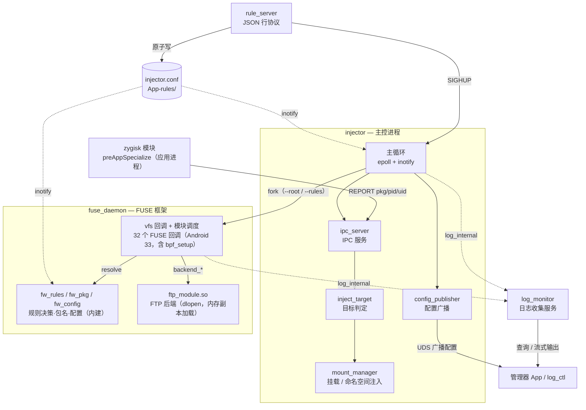

# 总体设计

面向维护者的架构说明：模块边界、进程协作与数据流。

## 1. 项目定位

Fuse-Proxy 运行在 **Android 13+（API 33~35）**，作为 root 模块的二进制核心组件，通过两项内核机制实现**应用粒度**的存储访问控制：

- **FUSE 用户态文件系统**：拦截应用对外部存储（`/sdcard`、`/storage/emulated/N`）的文件操作，按规则透明改写。底层真实物理存储固定为 `/data/media/<user_id>`（`STORAGE_BASE`），所有重定向最终归一到此。
- **挂载命名空间隔离**：检测 zygote 子进程，将定制的 FUSE 挂载注入目标应用的 mount namespace，规则只对目标应用生效。

核心能力：存储重定向（REDIRECT/ALLOW）、路径隐藏（HIDE，含跨应用隔离）、只读保护（RO）、沙箱隔离（SANDBOX）、命名空间注入、专属媒体 FUSE（为 `com.android.providers.media.module` 单独起实例，惰性启停）、配置广播（UDS 实时发布配置供管理器 App 消费）。规则语法见 `config.md`。

## 2. 进程架构

5 个可执行文件各自为独立进程，经 Unix Domain Socket 协作（另有仅 GNU、不安装的测试驱动 `global_replace_ctl`，不参与运行时协作）：



> 除 zygisk 通知外，injector 也可经周期扫描 `/proc` 主动发现应用；两条途径的关系见 §5.1。

> injector 同时维护**两棵** FUSE 树——全局 FUSE（`inject_global_fuse`，挂载于 `/mnt/nsp_global`）与媒体模块专属 FUSE（`inject_media_fuse`，惰性）。二者共用同一 `fuse_daemon` 二进制与 `--rules` 配置，挂载点不同。

### 2.1 injector — 主控

系统级守护，发现目标应用并为其注入 FUSE 挂载。

- **事件循环**：`epoll` 统一管理 inotify（配置变更）、IPC socket、异步挂载完成管道、FUSE ready 管道、定时器（周期扫描）。
- **目标判定**（`inject_target.c`）：包名匹配配置、系统应用过滤、隔离进程过滤。
- **挂载注入**（`mount_manager.c` + `ns_utils.c`）：进入目标进程 mount namespace，挂载 FUSE 并做 bind mount 恢复。
- **IPC / 广播**（`ipc_server.c` / `config_publisher.c`）：接收查询控制命令；以 JSON 经 UDS 发布配置（GET / STATIC / SUBSCRIBE）。STATIC 的 `global`/`apps` 段**复用 config_parser 已加载的 AppConfig 快照**（解析后的视图：路径已归一、内部 `?` 前缀已剥离、规则按确定性顺序排序，含类别段与 App-rules 分文件），不再对 `injector.conf` 做 `sscanf` 旁路重解析，也不触发 `load_config_rules`（那会替换 injector 的 live 配置）；`app_rules` 段仍回显磁盘上 `App-rules*/*.conf` 的**原始文件内容**。

### 2.2 fuse_daemon — FUSE 守护

由 injector 以 `<mnt> --root=< STORAGE_BASE> --rules=<injector.conf> --ready-fd=<fd> [-f -o ...]` 启动（`--mode`/`--global-root-fd` 已删：前者从未被读取，后者在 daemon 侧从未使用；`--root` 必须显式传递，`vfs_bpf_setup` 直接拼接它；日志级别默认 INFO，不占参数位），实现 **32 个** `fuse_operations` 回调（`vfs_ops` 初始化器的赋值成员数；Android 下另有 `.bpf_setup`，共 33 个）。
框架**自带规则能力**（V4 起规则引擎内建，模块只剩后端）：

- **规则决策**（`fw_rules.c`）：本进程内解析 REDIRECT/SANDBOX/HIDE/ALLOW/RO 与 FTP 前缀归属，输出声明式 `NspPathDecision`（见 `src/daemon/fw_rules.h`）；无 `<uid>/` 用户层的路径（挂载点根）不参与规则，直通处理。
- **后端分派**：决策命中 FTP 规则（`rr.is_ftp`）时经 `module_backend_lookup` 定位后端模块并改调其 `backend_*` 方法；未命中则本地直通（`module_backend_active()` 快速路径零开销）。后端模块**从内存副本加载**（memfd），磁盘文件被原子替换或就地覆盖都不会破坏运行中的映像。
- **打开中删除（open-unlink）**：本地路径由 `vfs_rename` 识别 libfuse 的 `.fuse_hidden<16hex>` 隐藏名并**直接 unlink 源文件**（本地 backing 支持 POSIX 的"先删名、后关句柄"），目录里不再出现隐藏文件——与 Android 自带 FUSE 的可见行为一致；删除前的属性快照供后续 `fstat`（内核 GETATTR 常常不带 fh）。后端路径（FTP/SFTP）仍沿用隐藏名：远端立即删除会让正在下载/上传的句柄失去数据源。此外 `.fuse_hidden*` **不是特殊条目**：`vfs_entry_visibility` 不按隐藏名过滤，readdir 看到就按普通条目列举（可 `getattr`/`open`），也不在列举时就地删除——本层本地路径不产生新隐藏名（上面的直删分支），磁盘上出现的残留来自旧版本 daemon 或下层 FUSE（设备上 `/data/media` 由 MediaProvider 的 FUSE 提供时，我们穿过下层 unlink 会让下层 libfuse 把名字改成 `.fuse_hidden` 等 RELEASE 再删），一律保留可见，便于取证与手工回收。后端路径（FTP/SFTP）仍用隐藏名兜底，其隐藏名同样按普通条目可见（只存活到最后一个句柄关闭）。  隐藏名判定必须在 `fw_route` **之前**完成：这次 rename 的真实语义是 unlink，源端按 `NSP_ACL_OP_DELETE` 路由（`rename_is_open_unlink()`），否则 ACL 的「存储根一级条目不可改名」结构规则会把「删除 `/sdcard` 下仍打开的文件」误拒成 EPERM（历史缺陷；回归 `test_open_unlink_toplevel.py`）。
- **uid→包名解析归框架**（`fw_pkg.c` 的 `fw_pkg_resolve`）：uid<10000 判为 `system`；否则查 `uid.map` → 读 `/proc/<tid>/status` 的 `Tgid` + `cmdline`，结果按 uid 缓存（重载时随代际失效）。解析出 `<pre-`/`zygote`/长度<3 的标记为"不可用于段匹配"（只能命中 `[GLOBAL]`），`system`/`unknown` 这类伪包另由 `pkg_resolvable()` 挡在类别层之外。包名是**配置语义的输入**（段匹配键 + 日志 `[pkg(uid)]` 标签），不能只存在于模块里——否则模块缺席时日志写 `unknown`、且 `MONITOR` 的类别层无从计算。规则引擎内部另有一份同源解析（`fw_rules.c` 的 static `br_get_app_cfg`，它需要 pkg 做 `$package` 变量展开与沙箱隔离）：两者同在框架进程内、算法同源、结果一致。

- **worker 线程数**（[fuse_threads.h](../include/fuse_threads.h)）：多线程 loop 的 worker 上限默认 `min(max(4, ncpu), 16)`（4 核 → 4、8 核 → 8、16 核及以上 → 16）。该上限只决定并发余量，不能隔离持共享锁的慢调用，也不能保证多个不可取消 I/O 同时阻塞时仍有空闲 worker。`--fuse-threads=N` 覆盖（`0`=单线程、`-1`=libfuse 默认 10），injector 按 `[GLOBAL] FUSE_THREADS` 下发；启动期参数，改它需重启 daemon。

- **COPY_FILE_RANGE 不接**（`fuse_daemon.c` 启动期调 libfuse fork 的 `fuse_disable_copy_file_range()`）：本 daemon 的 `vfs_ops` 没有 `copy_file_range`，libfuse 因此把请求交给高层回退 `fuse_lib_copy_file_range` → `fuse_fs_copy_file_range`，而后者在判断“操作是否存在”**之前**先取线程上下文（`fuse_get_context()`），上下文缺失的收尾窗口里按小偏移解空指针（现场崩溃栈：`pthread_getspecific` → `fuse_get_context_internal` → `fuse_fs_copy_file_range` → `fuse_lib_copy_file_range`，SIGSEGV）。关掉低层派发后，请求在 `copy_file_range_common()` 处直接拿到 `ENOSYS`，内核据此永久改走 read/write 循环（本 daemon 的 `vfs_read`/`vfs_write`，长期在用的路径），崩溃点不可达。GNU 开发构建链接系统 libfuse 3.18.3 无此 API，调用点用弱引用守卫（缺失则跳过）。

模块架构详见 `modules.md`。

### 2.3 日志子系统

- **log_monitor**：常驻收集服务，经 AF_UNIX `SOCK_STREAM`（抽象地址 `nsp_log_socket`）接收各进程 `log_internal`，并提供 `search`/`stream`/`clear`/`count` 查询。io/sys 自动落盘 `LOG_DIR/io.log`、`sys.log`（`push_log` 单漏斗暂存 64KB，stage 满 / 500ms tick 脏超 1s / 退出时刷盘；单文件超 2MB 轮转 `.1` 单备份，logcat 不落盘）。**行格式**：落盘（`io.log`/`sys.log` 都是）统一为 `时间|LEVEL|msg`（`persist_stage`）；查询与流式的**回包**只有 sys 通道带 LEVEL（`时间|LEVEL|msg`，见 `search_emit_line` 与 `dump_one_entry` 的 `with_level && type == 2`），**io 通道不带**（`时间|msg`，消息体本身即 `[pkg(pid)] [OP] path -> target`）——前端解析 io 时不要按含等级字段去切。`LEVEL` 是 `DEBUG`/`INFO`/`WARN`/`ERROR` **名称**（词法唯一出处 `nsp_log_level_name`/`nsp_log_level_parse`，见 `nsp_log.h`）——排查时可直接 `grep '|ERROR|'`，不必记 `|0|..|3|` 的映射；2026-09 之前的旧文件是纯数字等级，`nsp_log_level_parse` 仍接受，**未知等级字段判为无效行跳过**（不得退化成 `atoi`，否则 `INFO` 会被静默当成 0=DEBUG）。进程间**线协议不变**（`LOG_SYS:<数字>:`），故新旧二进制混跑仍可互通，改的只是渲染。**刷盘任何失败路径都不清空 stage**——暂存区是该批日志的唯一副本，退避期只跳过 `open` 重试，真正写出的数据才移除；stage 耗尽时按行拒收并计入 `dropped`。启动时把 `io.log.1` + `io.log` 载入只读快照，按**紧凑存储**（`DiskEntry` 的 `t`/`level` + 指向字符串池的指针，按实际行长排布）全量容纳，`DISK_READ_MAX`(8MB) 是防异常大文件的硬上界，查询按"磁盘在前、内存在后"拼接——故 `count`/`search` 不受条数截断。
- **丢弃可观测**：接收环（`entries`）满、合并队列（`batch_q`）满、落盘拒收这三处是仅有的静默吃日志点，各自累加原子计数，由 500ms tick 驱动的 `report_drops_once()` **限频（10s 至多一条）**写入 sys 缓冲，`search-sys` / `sys.log` 可查，稳态计数不变则零噪音。异步接收线程结束时置 `_Atomic disconnected`（release），回收方（epoll 通知路径与超时 tick 路径）**先 `drain_async` 抢救环内残留再 `free`**，否则线程末尾入环、notify 与置位错峰的日志会随回收永久丢失。
- **高频「稳定事实」日志按原因限频（`nsp_log_gate`，`nsp_util.c`）**：`LOG_DBG` 在 `log_internal` 里**不受级别过滤**（前身 `LOG_MON` 要求注入/规则转储恒可见，见该函数注释），所以挂在「每次查找 / 每个请求」路径上的调试行**不能靠 `--log-level` 压制**。这类行陈述的是稳定事实而非瞬时事件，逐条上报没有信息增量却能把 `sys.log` 刷满——线上实例：`fuse_daemon` 的 backing 放弃挂接（`vfs_backing_setup` 每个 dentry 查找都走一次，内核不缓存「没挂上 backing」的结论）被媒体扫描器反复触发的 `/0/MM1TT` 单路径刷屏。现统一走 `nsp_log_gate`：首次立即报（带真实路径），其后**每小时最多补一行**，带这段时间被抑制的条数与最近样本（`nsp_log_gate` 本身非线程安全，多线程调用方用一把短锁包住，见 `fuse_daemon.c` 的 `backing_decline_log`）。新增同类高频日志走这条出口，不要退化成逐条上报。
- **监控开关单点（`fw_route` + `fw_config_monitor_for`）**：`monitor_on` 是**配置开关而非路径决策**，不能绑在 `nsp_ok`（模块是否给出有效决策）上，也**不由决策结构承载**（V4 起 `NspPathDecision` 已无该字段，`fw_route` 经出参单独给出）。值由 `fw_config_monitor_for(uid, tid)` 给出：按 uid→包名做**三层合并**（应用段显式 > 类别段显式 `[USER_APPS[:uid]]`/`[SYSTEM_APPS]` > `[GLOBAL]`），与模块侧同一套作用域语义（模块内部仍算同一份值，只是不再跨 ABI 回传），结果按 uid 缓存（重载时随代际失效，热路径只读一次原子快照）。**框架为此自建一份 AppConfig 索引**（`config_build_from_view`，与模块同一实现），因此模块未加载/被 ban、路径无 `<uid>/` 用户层、模块未命中规则时开关照样正确——这正是历史缺陷「文件读写一切正常、IO 监控日志静默归零」的根因所在。开关词法唯一出处为 `nsp_switch_on()`（`ON`/`1` 为开），模块侧 `parse_switch_rule` 与框架侧合并共用。
- **ABI V4 的删除项**：`NspPathDecision` 的 `pkg`/`monitor_on` 与 `NspModuleOps.get_pkg` 已从 ABI 移除（该次变更把 `NSP_MODULE_ABI_VERSION` 升到 4；**当前值以 `include/nsp_module.h` 为唯一出处**——已到 5，见 `docs/modules.md` §6.5；旧模块须按新头重编译）。三者在"模块缺席"这一关键场景下本就无从提供，而框架与模块读同一份配置，故不存在语义分叉——包名解析（`$package` 展开与沙箱隔离用）与三层合并计算此前在模块侧的 `br_rules.c` 内，V4 把该文件原样搬入框架成为 `src/daemon/fw_rules.c`（模块侧已无副本），只是不再跨 ABI 回传。
- **丢弃与容量的两项评估结论（勿反复重议）**：① 生产者侧 LOG 环维持 `nsp_comm.c` 的 `kCap=2048` **不扩**——满环覆盖旧数据已由 `nsp_log_report` 限频 5s 上报（"comm: LOG 通道拥塞，覆盖旧数据 N 条"），症结是可观测性而非容量，扩容只抬高内存上界（单槽上限 16KB，理论 32MB→128MB）；② **不恢复** `persist_io_log` 的"无条件落盘"——它写的是独立文件 `persistent_io.log`（非 log_monitor 的 `io.log`）、仅 `NSP_ENABLE_IO_LOG`（debug）编译、且当前无任何查询出口，落了盘也无人可读；真要做兜底须连查询路径一起补，否则只是多一份磁盘 I/O（详见 `common.c` 注释）。
- **log_ctl**：CLI 客户端——查询日志、流式输出、规则编辑（`set-rule`/`remove-rule`/`validate-rules`）、拉取配置广播（`get-config`/`stream-config`）。规则编辑与 `rule_server` 共用 `nsp_rule_file` 行级实现（原子 tmp+rename 落盘）；`--config-dir` 可覆盖配置根（与 `rule_server` 同名选项一致），使其可在临时目录下测试。
- **控制面对端鉴权（B2）**：`rule_server` 与 injector 的 UDS 控制面在 dispatch 前取 `SO_PEERCRED`（`nsp_peer_cred`）核对调用者身份——仅靠 SELinux 域兜底不足（模块骨架的 sepolicy 已允许 `untrusted_app_all` 连 root 的 stream socket，任何本地进程都能发控制命令）。`rule_server` 的**高危命令**（STOP/QUIT/EXPORT_LOGS，以及 `SERVICE` 的 `start`/`stop`/`restart`——它们与 STOP 同等能力：停服、启停 injector/fuse_daemon/log_monitor、把全机访问日志导出到落点）仅 root 或 `NSP_TRUSTED_UIDS`（逗号分隔 uid，启动时读一次；生产由模块的 service.sh 设为管理器 App 的 uid，**未设置时只有 root**）可执行，其余查询/规则编辑命令与 `SERVICE status` 保持开放——`SERVICE` 按 action 判定，只看顶层 `cmd` 会让 `{"cmd":"SERVICE","action":"stop"}` 绕过 STOP 的白名单；injector IPC 要求对端 uid 为 root 或**与自报 uid 相等**（合法发送方只有 zygisk companion(root) 与目标应用自身），否则拒绝——避免任意进程污染 uid→包名映射而使 HIDE/RO 整体失配。
- **LOG_BATCH 协议**：应用还原等"一条日志对应整个挂载周期"的场景，周期内中间日志由 `log_batch_begin/end` 在 `log_internal` 层累积，`log_batch_end` 合并为**单条**（`LOG_KIND_MERGED`）发送。合并日志为单行 `[injector] <条目1>\t<条目2>...`（制表符连接，避免前端按行拆分导致 UTF-8 截断），级别固定 `LOG_DEBUG`。

## 3. 源码布局

```
src/
├── core/                 # 跨进程共享基础设施
│   ├── common.c          # 日志、路径消毒、IPC 收发、时区、cgroup 逃逸、存储路径合成
│   ├── nsp_util.c        # 纯 libc 公共库（UDS 地址、send_all、trim、mkdir_p、daemonize）
│   ├── nsp_comm.c        # 统一通讯线程（全进程唯一发后即忘出口）
│   ├── nsp_ini_store.c   # 通用 INI 段式存储（rule_server 私有静态库，非模块 ABI）
│   ├── nsp_rule_file.c   # 规则文件行级读写（rule_server 与 log_ctl 共享，原子落盘）
│   ├── path_trie.c       # 路径 Trie（零业务依赖，可独立单测）
│   ├── uid_map.c         # uid→包名映射（磁盘持久化 + 内存缓存）
│   ├── sys_pkg.c         # 系统应用包名缓存（pm list packages -s）
│   ├── fast_pid.c        # PID/进程信息快速读取
│   ├── fast_search.c     # NEON 优化子串检索（mountinfo 匹配）
│   ├── crash_dump.c      # 崩溃转储
│   └── build_info.c      # 编译期版本/git 哈希
├── config/
│   ├── config_parser.c   # 规则解析、AppConfig 管理、Trie 构建、变量静态性分析
│   └── path_vars.c       # 路径变量展开、真实目标分类
├── daemon/
│   ├── fuse_daemon.c     # FUSE 回调 + main（框架，含后端分派）
│   ├── fw_rules.c        # 内建规则引擎（REDIRECT/SANDBOX/HIDE/ALLOW/RO + FTP 归属 → NspPathDecision）
│   ├── fw_config.c       # 配置持有者（读取/热重载/下发 + 框架自建索引与 MONITOR 三层合并）
│   ├── fw_pkg.c          # uid→包名解析（框架权威：uid.map → /proc 回退 + 缓存）
│   ├── fd_close_queue.c  # 延迟 close 环形队列（Android backing fd 回收，fdq_*）
│   ├── cfg_watch.c       # 配置目录 watch 对账（App-rules 子目录热更新，cfg_*）
│   └── fuse_thread_naming.c  # 线程语义命名（pthread_create 截持）
├── module/               # 模块框架
│   ├── loader.c          # dlopen 加载/卸载、能力登记、分派、inotify 热插拔
│   ├── fault_fence.c     # 调用围栏（sigsetjmp 崩溃恢复）
│   └── module_guard.c    # 输出校验 + 熔断器
├── modules/              # 热插拔模块（.so）——V4 起只有后端形态
│   └── ftp/              # FTP 存储后端（纯方法模块，无 FUSE 实现）
│       ├── ftp_module.c  #   模块 ABI 入口（NspModuleInfo / init / ops）
│       ├── ftp_conf.c    #   模块配置解析（server 段、port 校验、# 注释边界）
│       │                 #   行级状态机：文件形态与配置下发视图共用一份语义
│       ├── ftp_mux.c     #   控制面 epoll + curl_multi 复用器（连接复用/并发）
│       └── ftp_backend_libcurl.c  #   路径映射 + 读写（数据面每文件独立句柄）
├── injector/             # 注入器（injector/inject_target/mount_manager/ns_utils/
│   │                     #   ns_global_replace/ns_mountinfo/ipc_server/
│   │                     #   config_publisher/reaped_managed）
│   └── global_replace_ctl.c  # 全局替换挂载测试驱动（仅 GNU）
├── zygisk/               # Zygisk 应用创建通知模块（仅 Android，双 ABI）
│   ├── zygisk.hpp        # Zygisk ABI 头（ISC，取自 Magisk，原样收录）
│   └── zygisk_module.cpp # preAppSpecialize 上报 → companion → injector
├── rule/rule_server.c    # 规则控制服务（JSON 行协议）
└── log/                  # log_monitor、log_ctl
```

外部依赖：`libfuse3`（**仅 fuse_daemon 直接用**，规则/后端模块均不链接）、`json-c`（配置广播/日志 JSON）、`libcurl`（仅 ftp_module，≥8.21.0）、`libssh2`（仅 ftp_module 的 SFTP，可选，见 `-Dsftp`）、`iconv`、`pthread`。C23 标准，`warning_level=3`，Release `-O3 -flto`。产物与源文件映射见 `meson.build`。

## 4. 规则系统

由 `config_parser.c`（解析/索引，编译进各进程）+ `src/daemon/fw_rules.c`（匹配与应用，内建进 fuse_daemon）组成。规则语法与作用域见 `config.md`。

### 4.1 双通道存储：Trie + 线性数组

按是否含通配符/变量分两条通道，是性能与灵活性的权衡：

- **纯静态规则**（无 `*?[]`、无 `$`）→ **Trie**（多叉前缀树，按 `/` 分段）。单次查询 O(路径段数)，且一次 `trie_lookup_full` 同时返回 hidden/ro/redirect/ftp 四类命中。绝大多数规则走此快路径。
- **含通配/变量的规则** → 线性数组（`hide_rules[]`/`ro_rules[]`/`redir_rules[]`），逐条 `fnmatch` + 前缀匹配。数量通常很少。

### 4.2 单次操作的热路径

```
FUSE 回调（如 getattr）
  └─ VFS_SETUP_CORE 宏：经 fw_rules_resolve 一次调用取回全部决策
       ① br_get_app_cfg(uid) ──────────── uid→AppConfig（2048 槽 seqlock 无锁读缓存，O(1)）
       ② br_sanitize_and_check_hidden ─── 路径消毒 + Trie 一次性解析（填 TrieMatch）+ 隐藏判定
       ③ br_to_real_path ──────────────── 复用 TrieMatch 的 redirect 结果 → 真实路径
  └─ 写操作额外：br_is_path_ro ────────── 复用 TrieMatch 的 ro 结果
```

`TrieMatch` 缓存使单次操作对两棵 Trie（app + global）的遍历从 6 次降到 2 次。上述整段在 `config_read_begin()`/`config_read_end()` 无锁快照内完成（见 §6）：持槽期间配置不会被替换，`config_read_end` 返回 false 时整个 resolve 重试。

### 4.3 真实路径解析优先级

`br_to_real_path` 按**作用域优先**逐层取首命中（`config.md` §2 的 应用 > 类别 > GLOBAL）：

1. **应用段**：先静态（Trie 命中，`TrieMatch.redir`/`redir_scope`），再线性（含通配/变量的 `redir_rules`）。
2. **类别段**（`USER_APPS[:uid]` / `SYSTEM_APPS`）：同上。
3. **`[GLOBAL]`**：同上。
4. **sandbox 重定向**：`SANDBOX ON` 时，除让位路径（`/Android/data|obb|media` 三个容器本身、应用自身 `/Android/{data,obb,media}/<pkg>`、他包 `Android/data|obb` 子树）之外的访问一律重定向到 `<STORAGE_BASE>/<uid>/Android/data/<pkg>/sandbox/`（目录名默认 `sandbox`，可经 `[GLOBAL]` 段 `SANDBOX_DIR` 配置项覆盖，配置发布单点下发；三层 OFF 否决语义见 `config.md` §2/§3）。`/Android` 本身也在镜像内——应用在它下面新建的条目（`/Android/123.txt`、`/Android/<自己建的目录>`）必须落镜像，落真实目录等于沙盒没开。
5. **fallback**：`STORAGE_BASE/<user_id><sub_path>`。

> Trie 与线性通道是**同一作用域内的等价实现**——Trie 只是静态规则的加速索引，不是更高的优先级层：同层内静态命中先于该层线性规则，但**跨作用域不得互相压过**。旧实现先取「任一作用域的静态命中」再才看线性，于是 `[GLOBAL]` 的静态 REDIRECT 会压过应用/类别段的通配/变量规则（与 `config.md` §2 相反，`test_rules.py` §21 守护）。
> `?` 前缀是内部标记，由 parse 阶段对 ALLOW 和相对路径 REDIRECT 自动生成，表示"相对当前用户存储"。

### 4.4 跨应用隔离

`br_is_other_app_pkg` 判定调用方访问 `/Android/data|obb/<他包>/`。范围只有这两棵子树（`media`/`obj` 历史上不隔离，扩范围会改变既有行为）。隔离与 `HIDE` **同口径**：判定落在 `br_sanitize_and_check_hidden()` 单一出口上，`resolve`（getattr/open）与 `probe`（readdir 条目过滤）共用它，故「看不见 = 打不开」。旧实现只在 probe 侧过滤，任何按名打开的命令都能读到内容（当时只能靠 `HIDE Android` + 逐包 `ALLOW` 临时兜住）。判定现已上移到该出口，probe 各路径仍显式叠加同一判据（快路径不经过 sanitize）。

放行链（顺序即优先级）：目标目录名等于调用方**基础包名**（`com.x:push` 与 `com.x` 同包，`br_pkg_same_base`）时放行；调用方包名不可解析（`system`/`unknown`，即 root 与系统工具）不隔离；`[GLOBAL] ALLOW_CROSS_APP_DATA ON` 全局关闭隔离（默认 OFF = 生效）；**该路径上有显式声明**（`ALLOW`/`HIDE`/`RO`/`REDIRECT` 任一作用域，`br_decl_present`）时隔离让位，交规则层自己裁决——隔离是「没有规则时的默认边界」，不是压过用户配置的硬墙；调用方命中白名单（`[GLOBAL] ALLOW_CROSS_APP_PKGS`，按调用方自身包名，不做 uid 兜底）、platform 签名、或能力档（`fw_rules_cross_app_access`，见下节）即放行。

能力档 `NspXAppAccess`（`fw_rules.h` 的 `nsp_xapp_access_of()` 是排序的唯一出处）：`FULL`（白名单 / platform 签名 / `MANAGE_EXTERNAL_STORAGE`）放行 `data` 与 `obb`，`OBB`（能装包：`INSTALL_PACKAGES` 权限或 `REQUEST_INSTALL_PACKAGES` appop）只放行 `obb`，`NONE` 隔离。这三档对应原生挂载模式的两档（`PASS_THROUGH` 与他包 `obb` 的 `INSTALLER`）；逐格依据即本节三档定义（`FULL`→`data`+`obb`、`OBB`→`obb`、`NONE`→隔离），改档位须同步 `tests/test_rules.py` 与 `tests/test_acl.py` 的放行矩阵。resolve 侧（`br_isolation_blocks`）与 readdir 列举（`br_isolation_hides`）是同一实现 `br_isolation_impl` 的两个入口，差别只在隔离命中时记不记日志；`fuse_daemon` 的列举过滤与 ACL 的 `NSP_PATH_OWNED` 分支调同一判据（前者 `fw_rules_cross_app_access`，后者经 `nsp_xapp_access_of`），三处不会分叉。

**沙盒不参与跨应用裁决，也不接管 `/Android` 的原生子树**：`SANDBOX ON` 的调用方访问下面四类路径时，`br_to_real_path` 的沙盒分支直接落回真实路径，不做镜像改写——他包 `Android/data|obb` 子树（`br_path_other_app_subtree`）、三个容器本身 `/Android/data|obb|media`、应用自己在三个容器里的私有目录（后两者由 `br_path_android_passthrough` 判定）。改写会把原生的判据整个掩盖掉（能力放行者读到空目录，非放行者拿到的 ENOENT 也不是原生那个原因）；容器本身让位还有一层：ACL 把三者当骨架目录（readdir 由 ACL 拒绝），容器里每个 `<pkg>` 要单独按调用方裁决，镜像化后这些裁决全部对着空目录做。这四类之外的 `/Android` 路径（`/Android/123.txt`、`/Android/<自己建的目录>`、他包 `/Android/media/<他包>`）与其它共享目录一样进镜像。旧实现是「沙盒生效即无条件豁免隔离」，那条口子随沙盒让位一并删掉，否则沙盒 ON 反而比原生更松。已知边界：`uid.map` 是 uid→单包名，旧 `sharedUserId` 共享 uid 的两个应用会互判「他包」——现代 Android 上罕见，逃生阀同上（见 `config.md` §4.1）。

**沙盒骨架补建**：规则决策出配置读槽之后补建沙盒落点及其 `Android` 根，不预建 `data/obb/media` 容器；失败只记限频日志，不改已算出的路由。新增 `Android` 物化走 `common_mkdir_storage_child()`：从可信存储根 dirfd 逐组件 nofollow 打开既有父目录，子目录也不跟随符号链接，属性只经固定 fd 继承；`mkdirat` 返回 EEXIST 时不改既有目录属性。它不负责修复原有路径式补建/回调的全部符号链接语义，也不保证 mkdirat 到 openat 之间仍是同一个新 inode。没有永久“已就绪”TLS缓存，删除或配置换路径后仍重验。

**backing 直通只在 media 实例里开**（`vfs_backing_setup`）：全局实例（服务所有被注入应用，dentry 全应用共用）**一个 dentry 也不挂 backing**，全部回落 daemon 全权 mediation。两条理由：① 隔离开生效时 `data`/`obb` 的可见性取决于调用方，backing 之后内核绕过 daemon，per-caller 裁决无从落地（该子树此前直通等于隔离整体失效）；② 更要紧的是 DAC——backing 之后的下层 I/O 由内核在**发起请求的应用进程上下文**里直接打到真实文件（lookup/create/opendir 都按调用方凭证判），而 `/data/media/0` 整棵树归 MediaProvider（`10277:1023`、顶层目录 `0770`、属组 `media_rw`），任何应用都过不了。backing 结论按 dentry 缓存、无法按调用方分别裁决，故共享实例上这条路只能整体关掉（线上实测：只写 `ALLOW /Download` 或不写路径规则时，注入后的应用写 `/Download` 反被内核 EACCES 拒绝）。media 实例（`--media-fuse`，调用方恒为 MediaProvider）保留直通，按路径门 `fw_backing_mediation_required_for()` 逐路径裁决。

`ALLOW` 也算"要求仲裁"的维度（`fw_rules.c` 的 `br_cfg_touches_data()` / `br_cfg_mediates_path()`）：它只声明"这一层放行"，不代表可以让内核代跑 IO。旧实现把 ALLOW 当直通跳过，正是上面 ② 的触发点。代价是全局实例的 I/O 回到全量仲裁路径（等于是把 `--no-bpf` 变成全局实例的恒定行为），换来的是"注入后与未注入行为一致"。

观测：隔离拒绝与 `HIDE` 一样是静默 ENOENT，故 `br_note_isolation()` 记限速 DEBUG（首命中 + 每 1024 次一条，带调用方包名与判定路径），现场据此区分「我们在拦」与 ROM/规则问题。

**probe 的入参契约是带 `<uid>/` 层的原始 FUSE 路径**（引擎自行剥层后匹配，见 `NspQueryCtx` 注释）：两个调用点（readdir 本地扫描、虚拟目录判空）若传剥过层的路径，探针会因「无用户层」直接早退，等于列举侧完全不过滤——HIDE 条目照旧列出而 stat 报 ENOENT（`test_rules.py` §25 守护）。该标志只存在于 `NspProbeResult`（`is_other_app_pkg`），`NspPathDecision` 不携带。`CONFIG_DIR` 下所有访问无条件隐藏。

### 4.5 决策强制（框架单点）

模块只声明「路径该怎么表现」（`NspPathDecision`），**errno 映射与权限策略不由模块决定**，集中在框架：

- `fw_route()`（`fuse_daemon.c`）是所有回调的唯一入口，按操作类别 `VFS_OP_READ` / `VFS_OP_MUTATE` 强制：`appear_missing` → `ENOENT`（**所有**回调统一，写类不再是 `EACCES`）、`read_only` → `EROFS`（root 豁免由框架持有）。`open`/`access` 是否算「写」取决于 `flags`/`mask`（`O_RDONLY` 打开只读路径必须放行），触发条件留在回调内，但判定统一走 `vfs_check_read_only()`。
- **属性一律原样上报底层真实值**：`NspPathDecision` 只携带 `valid` / `appear_missing` / `read_only` / `virtual_kind` 与最终真实路径，**不含**任何属主/权限覆盖字段。V3 时代曾有的 `attr_override`（`NSP_OV_MODE/UID/GID` 位图）与框架侧落实它的 `vfs_apply_attr_override()` 已随 V4 连同 ABI 一起删除——规则语法从未支持该能力、引擎恒不置位，属「无生产者」的预留实现，违反 YAGNI。删除理由：挂载只带 `allow_other` 而无 `default_permissions`，内核对 `open/read/write` 本就不做 DAC 判定（仅 `access(2)` 下发 `FUSE_ACCESS`，且由 root 守护进程执行的 `access()` 必然通过），模块也不具备 POSIX DAC——伪造属主拦不住任何访问，只会误导读取方。`readdir` 的 filler 只消费 `st_ino` 与类型位（`fuse_add_direntry` 不读 uid/gid），故条目侧的属主赋值同样是死代码。（历史注记见 `fw_rules.h` 的 `NspPathDecision` 头注释。）
- **早年的「默认伪造模式」（属主改写为访问者、重定向目录强制 0777、skel 目录强制 0755）连同 `--preserve-perms` 开关同样已删除**，与上一条同一理由。
- **共享存储的落点形状由树决定，新建与落位同一口径**：`nsp_new_entry_attrs()` 收尾新建条目（create/mkdir/mknod/symlink 与父目录补建，见 §4.2 的沙盒/新建条目路径），`nsp_rehome_moved_entry()` 收尾 rename 落位（rename 不产生新条目，条目会带着**来源树**的属主与 mode 落地）。两条路径共用的规则是：属主/属组跟随父目录；落点在共享存储（`<存储根>/<用户层>` 且不在根层 `Android/{data,obb,media}`）时，mode 再按固定形状补位——文件 0660、目录 0770，只加位不减位，目录的 setgid 跟随父目录；SELinux 上下文照抄父目录。宽度为什么固定：MediaProvider 自己建条目就是这两个位，按父目录实际位去推会多出 0664/0661 之类的第四条形状；调用方 mode 仍然有效，只是不能再把共享存储里的条目削得比树更严。原因在可访问性而不在美观：MediaProvider 按调用方凭证做 DAC，`属主是某个应用、mode 0600` 的条目除写入者自己以外全部 `EACCES`（实测：同目录 0660 且属组 `media_rw` 可读，0600 或属组是应用自己的 0660 都不可读）。判据只按落点归类、**不按「属主是否与父目录相同」**：私有树与共享存储可能同属一个 uid（私有树里的文件本就归应用），属主一致却正是来源 mode 被削成 0600 的现场——旧实现按属主早退，于是这条路上根本没补位。私有树（根层 `Android/{data,obb,media}`）的落点按另一条窄口径处理：`nsp_rehome_moved_entry()` 仍直接早退（rename 进私有树不补位），新建的**普通文件**在 `nsp_new_entry_attrs()` 里只补属组读写位（0060）。私有树的属主与属组由 installd 体系给出（包目录 2770 归 `ext_data_rw`），能穿过包目录的只有全盘访问能力应用与系统组件（MediaProvider 的直通视图、MES 文件管理器），而应用下载到私有树的条目常被自己的 umask 削到 0600，这批身份便读不到（实测 MediaProvider 身份读 0600 条目 `EACCES`、读 0660 条目成功）。只补组位：不加 o 位（不暴露给任意应用）、不加 x 位（不造可执行文件）、不动属主位（显式建的 0400 不会变成可写）。目录不补——树的隔离靠目录位，连目录一起放宽才会造出第二个共享存储；setgid 继承与私有树里原有的 0700/2700 口径不变。符号链接跳过（chmod 会穿透链接）。这不是把属主「伪造成访问者」（上一条），而是把条目的归属与宽度换到它现在所在的树。回归 `tests/test_entry_perms.py`、`tests/test_move_landing.py`。

> 位图而非「特殊值哨兵」：若用 `mode == UNSET` 表示不改，模块惯用的 `memset(out,0,...)` 会静默变成「权限清 0 + 属主 root」。位图让零初始化等于「什么都不改」。

收敛前，`hidden`/`ro` 判定散落在 27 个回调里各写一遍（写类还各自映射 `EACCES`），新增回调极易漂移。回归见 `tests/test_decision_enforce.py`（逐回调 errno 矩阵）。

### 4.5.1 访问控制（`fw_acl.c`，对齐 Android 原生 FUSE 的用户态策略层）

挂载层我们与 AOSP 等价：**都不加 `default_permissions`**（AOSP vold 注入挂载参数处有明确注释：不想让内核在路由到 daemon 之前做低层权限检查），属主/权限由 daemon 侧合成。AOSP 的唯一门是 FuseDaemon 的 is_app_accessible_path()（uid < `AID_APP_START`(10000) 直接放行、卷根不可列举、`Android/data|obb/<pkg>` 他包一律 `ENOENT`、`.nomedia` 放行），媒体语义再外包给 MediaProvider 的 13 个 JNI 判定。旧版本我们**完全没有这一层**：daemon 以 root 执行全部 syscall，任意应用可删改挂载内任意文件。

现在的落地方式与「决策强制单点」同一纪律：

- **唯一执行点** `fw_acl_check()` 由 `fw_route()` 在规则决策**之前**调用一次（每次调用即「这个调用者能不能碰这条路径」），回调里不得再写访问判定；`tests/test_acl.py` 的静态契约断言 `fuse_daemon.c` 里 `fw_acl_check(` 只能出现一次。
- **判定表只有一份**：纯函数 `fw_acl_decide(q, id)`（可直编单测，不依赖全局状态），路径分类 `fw_acl_classify()` 集中处理「卷根 / 骨架目录 / 他包私有目录 / `Android/media` / 顶层条目 / 普通路径」，不散落字符串比较。
- **三码不混用**：`ENOENT`=看不见（他包 `Android/data|obb`）、`EACCES`=存在但不许（骨架目录列举、顶层结构违规、`access` 的 X_OK）、`EPERM`=结构层不许（骨架/顶层目录的增删改名）。
- **配置耦合只有一处**：「他包私有目录不可见」沿用既有 `[GLOBAL] ALLOW_CROSS_APP_DATA`（`fw_rules_cross_app_isolated()` 是开关唯一出处），否则这条 AOSP 默认会让显式放行的用户突然失效；跨应用放行白名单（`[GLOBAL] ALLOW_CROSS_APP_PKGS` → `fw_rules_cross_app_pkg_allowed`：按调用方自身包名精确匹配，独立于 appops）、platform 签名、能力档（`fw_pkg_manages_external` 的 `MANAGE_EXTERNAL_STORAGE` 与 `fw_pkg_can_install_packages` 的能装包判据，同一次 appops 查询，受 `[GLOBAL] ALLOW_CROSS_APP_BY_CAPABILITY` 控制、**默认开**）与**同 uid 多包豁免**（`fw_pkg_uid_for_package` 解析目录属主 uid，与调用方 uid 相同即同一 app 身份——Linux DAC 只认 uid）都在 `fw_rules` 的隔离判定同点叠加。`legacy storage` 不再是跨应用放行依据：Android 16 已无 legacy 挂载模式，它只影响非私有路径的写入语义。ACL 侧不另写一套判据——`NspAclIdentity` 只承载事实（白名单/特权/能力位/能装包位），档位由 `nsp_xapp_access_of()` 判。
- **fail-open 名单明确**：uid < 10000（root/shell/system）与包名解析失败一律放行——ACL 是「多一道门」，不能变成单点故障（解析失败把应用挡在自己的 data 目录外比越权更难排查）。能力位（`MANAGE_EXTERNAL_STORAGE` / 能装包，appops 判定）不是 fail-open 项而是档位输入：**仅在 `ALLOW_CROSS_APP_BY_CAPABILITY ON 时**参与跨应用裁决，关着时 ACL 与规则层都不查 appops（顶层目录创建那条旁路除外，见下条）。
- **顶层目录创建的能力旁路独立于该开关**：`NSP_PATH_TOPLEVEL` 的 `MKDIR` 分支在 `id->manage_external` 为真时直接 `NSP_ACL_ALLOW`（`src/daemon/fw_acl.c`），对齐 AOSP `shouldBypassFuseRestrictions`；原生里持有 All files access 的应用走 lowerfs 直通、根本不进 FUSE 结构规则，本项目把所有应用收进代理视图后必须补回，否则文件管理器建不了顶层目录，而同目录建文件却成功。该能力位由 `fw_acl_check` 的 `acl_fill_capabilities(q, id)` 按需补齐：路径分类为 `NSP_PATH_TOPLEVEL` 且 `op == NSP_ACL_OP_MKDIR`（与 `ALLOW_CROSS_APP_BY_CAPABILITY` 无关，开关 OFF 也查），或路径分类为 `NSP_PATH_OWNED` 且总闸开着（此时一次查询同时得到两个能力位）。其余回调不付这次查询。回归 `tests/test_acl.py`、`tests/test_acl_nonintrusive.py`。
- **与 AOSP 的有意差异（超集，不是缺省）**：普通条目的 `chmod`/`chown` 下发到 backing（AOSP 的 `handle_setattr` 静默丢弃 mode/uid/gid 变更），因为我们的 backing 是真实文件系统、属性可以真的保存；结构条目（`fw_acl_is_structure_entry`）的 `chmod`/`chown` 与带 `system.posix_acl_access` 条目的 `chmod` 静默丢弃后成功（放行等于给每个应用一个把 `/sdcard/Download` 改成 0700/2700 的开关）；`access(X_OK)` 对文件保守放行、留给内核在 exec 时按 `MS_NOEXEC` 拒绝（回调里判 ACL 时还拿不到 stat，宁可多一层也不误伤目录的 X_OK）。

回归：`tests/test_acl.py`（47 条纯逻辑断言 + 静态契约）。

### 4.6 虚拟目录性质（`virtual_kind`）

引擎在决策里额外给出 `NspVirtualKind`（`NspPathDecision` 与 `NspProbeResult` 各带一份），只用于**让重定向的虚拟名字在视图里自洽**，不参与规则求值、不改变重定向指向：

| 取值 | 含义（全部按 `REDIRECT <vpath> <target>` 的**第一参数**理解） | 框架动作 |
|---|---|---|
| `NSP_VK_ANCESTOR` | 该路径是某虚拟前缀的**祖先** | 底层缺失时合成目录属性；`rmdir` 前用 `fw_virtual_dir_empty` 判空（祖先恒非空） |
| `NSP_VK_TARGET` | 该路径**本身**是某虚拟前缀（会被重定向） | 同上合成目录；且 readdir 逐条目探针**跳过真实同名条目**，改由虚拟目录合成提供该名字 |
| `NSP_VK_NONE` | 普通路径 | 无特殊处理 |

`ANCESTOR` 优先于 `TARGET`（祖先性质决定是否合成目录，语义更强）。消费点集中在 `fuse_daemon.c` 的 `getattr`（缺失时合成 `S_IFDIR`，mode/属主继承上级目录）、`readdir`/`opendir`（容忍虚拟目录的底层 `ENOENT`/`EACCES`）、`readdir` 条目过滤、`rmdir`。

**命名陷阱**：`NSP_VK_TARGET` 与 `trie_is_redirect_target()` 的名字都沿用历史，判的是「**虚拟前缀**」，**与"重定向的真实目标（第二参数）"无关**——真实目标仍是普通路径，照常列举与访问。因此 `REDIRECT /Shadow/ /Docs/` 的可见效果是：列表里的 `Shadow` 指向 `/Docs`（真实同名条目不再单独出现），而 `Docs` 本身依旧可见可读。

**为什么"跨作用域并集"不构成偏差**：`br_is_redirect_target` / `br_is_virtual_ancestor` 对**调用者生效的三层**（本应用段 + 该调用者的类别段 + `[GLOBAL]`）取并集，而 REDIRECT 的"是否存在"本来就是这三层的 OR（首命中只决定**指向哪**），故并集 ≡ 调用者的生效规则集。已实测：非生效层（如调用者走 system 分支时写 `[USER_APPS:0]`）写虚拟前缀既不遮蔽真目录、也不生成幻影目录；生效层则正常遮蔽/合成；作为重定向**目标**的真实目录完整可见。

### 4.7 FUSE 事件通道（`fw_events`）

**目的**：让扫描侧（MediaProvider 侧进程 / Media-Provider-Manager）不必整树重扫——**谁写过什么**由 FUSE 侧直接告诉它。本项目**不扫描媒体、不建索引、不生成缩略图**，只回答「这个路径现在是什么」和「刚刚有谁写过它」；判断"要不要进媒体库"完全是对方的事（分工见 MPM 仓库的 `FUSE-EVENTS.md`，接口 v5 已冻结）。

**开关**：`[GLOBAL] FUSE_EVENTS`，默认 **OFF**。关闭时 `fw_events_start()` 在创建任何线程/socket **之前**返回：零线程、零 socket、零堆分配；IO 路径上只多一次 `relaxed` 原子读（`fw_events_active()`）。

两条 AF_UNIX **抽象命名空间** socket，都由 `fuse_daemon` 提供：

| socket | 类型 | 方向 | 用途 |
|---|---|---|---|
| `nsp_fs_events` | `SOCK_DGRAM` | 服务端推送 | 客户端 `{"cmd":"SUBSCRIBE","reply":"<自己的抽象地址>","filter":{"types":[...]}}`，此后收 NDJSON 单行（≤1KB）：`write_done`/`write_denied`/`media_refresh`/`ping` |
| `nsp_fs_query` | `SOCK_SEQPACKET` | 一问一答 | `{"cmd":"QUERY","v":1,"spath":"<绝对存储视图路径>","uid":N,"seq":N}` → `{"v","seq","ok","exists","denied","reason","scope","rule","spath","rpath","vol"}`（`scope`/`rule` 是归因，见下） |

**通道身份 ≠ 被查询身份**：两条 socket 都用 `SO_PEERCRED`/`SCM_CREDENTIALS` 校白名单（root(0)/system(1000)/media_rw(1023) + **自动解析的 MediaProvider 进程 uid** + `[GLOBAL] FUSE_EVENTS_UIDS` 追加），**只回答"对端有没有资格连"**；事件里的 `uid/pkg` 由 daemon 按被代理的调用者解析，QUERY 里的 `uid` 直接采信请求方声明的值（调用者是 MediaProvider 一侧，它知道真正发起扫描的应用是谁）。

**白名单为什么必须自动解析 MediaProvider 的 uid**：消费方（MPM）是跑在 MediaProvider 进程里的 Xposed 模块，`SO_PEERCRED` 拿到的是**那个进程**的 uid——实测 **uid=10277**（设备 OPD2404 / Android16，包名 `com.android.providers.media.module`——该 ROM 用的是不带 google 前缀的 AOSP 名，只认 google 名等于白名单落空），既不是 1000(system) 也不是 1023(media_rw)，光靠写死的默认三项等于把通道唯一的消费方拒掉（通道"开着但用不了"）。uid 随 ROM/多用户变，包名才是稳定锚点：daemon 启动时（仅 `FUSE_EVENTS` 打开时）从 `/data/system/packages.list` 解析 `com.google.android.providers.media.module`、`com.android.providers.media.module` 与 `com.android.providers.media` 三个包名的 uid（唯一出口 `fw_pkg_uid_for_package()`，与 `fw_pkg_is_privileged` 同一份文件、同一个测试路径钩子、同一套代际缓存），去重后并入白名单。**只认解析出来的 uid**——包名不可由请求方声明，否则任意进程自称 MediaProvider 就能连上；解析失败（文件不可读/无该行）只少这一项并记一条 DEBUG，通道其余照旧。

**事件字段的三个路径域**（对接最容易错的地方）：

| 字段 | 口径 | 例 |
|---|---|---|
| `vpath` | 相对 `/storage/emulated/<user>` | `/Pictures/a.jpg` |
| `spath` | **存储视图**绝对路径（喂扫描的唯一正确路径域） | `/storage/emulated/0/Pictures/a.jpg` |
| `rpath` | 真实落盘路径（仅诊断，**write_denied 不带**——文件没落盘） | `/data/media/0/Pictures/a.jpg` |

`spath` 恒为**视图**口径（不受 `--root` 影响，唯一出口 `common_view_path()`），这样 REDIRECT 落点在对方看来仍是应用以为的那个路径域。`rename` 额外带 `src_vpath`/`src_spath`；`write_denied` 额外带 `errno`（`EROFS`/`ENOENT`/`EACCES`/`EPERM`/`ENAMETOOLONG`/`ENOSPC`/`EDQUOT`——容量不足也是"写没落盘"的可解释原因，而 `EIO` 一类瞬态错误属噪声不发）且**必须也带 `spath`**（写被拒时告诉对方"本应落在哪"）。
**`media_refresh`：FUSE 侧主动要求「补一次媒体扫描」**（`write_done` 只说「有人写过」，本条说「这个落点现在需要立刻进媒体库」）。字段：`reason`（`redirect_write` = 写经 REDIRECT/沙盒改写了落点；`ftp_upload` = 后端模块（FTP）上传收尾成功）、`media`（`image`/`audio`/`video`，按落点扩展名判定，**非媒体文件整条不发**）、三域路径同上（`spath` 是喂扫描的视图路径）。触发点两处：命中改写的写操作在发布 `write_done` 后追发一条（落点与默认真实路径不同才算改写）；后端（FTP）写意图句柄的 FLUSH/FSYNC 收尾成功后发一条——后端内容不产生本地 `write` 事件，没有别的时机。订阅要显式在 `filter.types` 里带 `media_refresh`，不带就只收旧两类（新类型不会让旧订阅者出错）。

**`scope`/`rule`：这条结论由谁裁决**（QUERY 的归因字段，目的是让对端在冲突时按 FUSE 真值让位，而不是自己另判）。`scope` ∈ `app`/`cat`/`global`/`none`（空 = 无规则/沙盒/隔离等无作用域声明的情形），`rule` ∈ `allow`/`hide`/`ro`/`redirect`/`sandbox`/`isolation`/`none`。两者**只描述归因、不参与判定**，与 `reason` 并列：`reason` 说「表现成什么」，`rule` 说「是谁让它这样」（`allow` 与 `redirect` 在 `is_redirect` 上都是 true，只有 `rule` 能分开「放行到自身」与「改写到别处」）。旧 daemon 的响应里没有这两个字段，对端按未知处理。

**不变式**：

- **IO 路径绝不阻塞**：埋点只做一次 `memcpy` 进 4096 槽有界环（满则丢最旧并累加 `dropped`），由独立线程 drain；发送一律 `MSG_DONTWAIT`，订阅者塞满就计数、连续失败 16 次摘除。无订阅者时事件不入环。
- **200ms 同路径合并**：窗口自首次到达起算，last-wins（一次 open→多次 4KB 写→close 收敛成一条，扫描侧不会被逐块写放大成事件风暴）。合并键是**事件类型 + 路径**：同一路径的 `write_done` 与 `media_refresh` 是两条独立事件，不互相覆盖。`seq` 在发布时分配，丢弃/合并都会让它**跳号**——这正是消费端识别丢帧的信号；`ping` 每 5s 带"自上次心跳以来"的 `dropped` 增量。
- **判定不在这里**：QUERY 只调 `fw_acl_check`（访问控制）与 `fw_rules_resolve`（规则），自己不写任何 hidden/ro 判定；六类响应互不混淆，`ok=0`（不认识/无规则）与 `denied=1`（被规则拒绝）**不得复用**，拥塞另用 `busy=1`。
- **exists 有 200ms TTL 缓存，且在该路径 `write_done` 时立即失效**——否则"刚写完立刻查"会拿到 `exists=0` 漏扫。处理器内除缓存未命中的一次 `lstat` 外不做阻塞 IO，绝不回调 MediaProvider。

**通道归属固定给全局实例**：两个实例（全局、媒体）都曾调用 `fw_events_start()` 抢同一个抽象名——内核对名字唯一，先 bind 者赢，输的那条实例的应用事件**一条也发不出去**，外部表现只是「事件功能随机全哑」，而现场只留一条 WARN 滚在日志里，事后无从查。现在**媒体实例不建立事件通道**（`g_is_media_fuse` 早退：`/mnt/nsp_media` 只服务 MediaProvider，应用事件本就该走全局那条）。任何一步失败（ring 分配 / eventfd / socket / bind / passcred / listen / 线程）都把**阶段名与 errno** 写进 `LOG_DIR/events_socket.status`，成功或开关关闭时删除该文件；`log_ctl events [api]` 结合该文件、`/proc/net/unix` 与 `/proc/<pid>/fd` 实测「此刻谁绑着这个名字」，给出 `ok` / `missing` / `unknown-owner` / `media-owner` / `foreign` / `disabled` 与处置提示（`log_ctl status` 同时带一个 `events` 块）。

## 5. 进程协作

### 5.1 注入流程

1. injector 启动先 `inject_global_fuse` 挂载全局 FUSE；若 `com.android.providers.media.module` 在目标之列，惰性起媒体专属实例。
1b. **就绪后的启动扫描**（v1、非 passive）：`repair_stale_app_mounts_at_startup` 遍历进程，只处理「挂着项目 FUSE 但连接已断」的那些——injector 重启不重建旧进程命名空间里的挂载，它们此后访问存储一律 `ENOTCONN`（内核只把 superblock 标成断开，mountinfo 条目仍在），杀模块进程、重启模块都没用，只有杀应用进程或重启设备才恢复。判据分两层：挂载状态来自 `statx` 快路径 ⇒ 连接已证明可用，直接跳过、一次探测都不做；只有结论来自 mountinfo 兜底扫描时才做一次 `statfs`（`ns_mount_conn_state`，必落超级块、不被 FUSE 属性缓存挡住），返回 `ENOTCONN`/`ECONNREFUSED` 才清理重挂。v2/v3 不适用（emulated 由全局替换统一提供）。同一判据也挂在两条挂载路径的「已存在项目 FUSE ⇒ 跳过」分支之前：注入前先查一次，死连接先清再挂。崩溃恢复重挂（remount_all_tracked）走的是同一个 fast_pid_each，而它按 PID 缓存跳过「本进程处理过的 pid」——守护进程崩溃后这些 pid 的挂载恰好是断的，所以恢复遍历前必须先 fast_pid_cache_clear()，否则只会看到崩溃之后新起的进程，活着的应用一个都不重挂（真机症状：日志报「重挂 0 个」而应用访问存储仍然失败）。

   `--passive` 不执行这次扫描，以免启动等待遍历存量进程。此模式只靠后续 IPC 或应用重启重新注入：旧存活应用若仍挂着断开的 FUSE，可继续收到 `ENOTCONN`，不保证随 injector 重启自愈。运行期 FUSE 崩溃后的已追踪应用重挂不受此启动扫描开关影响。
2. 经 zygote 子进程检测（`fast_pid` + `/proc` 扫描，timerfd 驱动）发现新启动应用。
3. `inject_target` 判定是否为目标（含 `SKIP_SYSTEM_APPS` 过滤、隔离进程过滤）。
4. 命中则 `mount_manager` + `ns_utils` 进入其 mount namespace 挂载 FUSE。
5. 此后该应用对 `/sdcard` 的访问经 FUSE → 内建引擎（`fw_rules`）匹配。

**视图就绪语义（应答三态 OK / DEFER / ERR）**：应用在 zygote `preAppSpecialize` 里经 companion 上报并等待 injector 的应答，收到后才继续 specialize。应答即"应用能否往下跑"的唯一信号：

- `OK`：**无需任何视图操作**——v3 全局视图、v2 非目标且已还原、隔离进程/zygote、进程已死、FUSE 暂不可用，或 pre 通道判定非目标。
- `DEFER`：**仅 v1 目标应用**。pre 通道**只裁决、不挂载**：此刻进程还在 zygote 的挂载命名空间里（部分 ROM 该 ns 里就有 `/storage/emulated`），在这里挂载等于把项目 FUSE 装进 zygote ns——之后 fork 的每个应用（含非目标）都会继承它，且 `cleanup_app_mounts` 只会在应用自己的 ns 里卸载，这份挂载没人能清。应用自己的 ns 要到 `postAppSpecialize` 才成立，那才是唯一该挂载的时机。模块把进程记为 pending：proto<3 的旧模块在 `postAppSpecialize`（**仍早于应用 Java 代码**）发 `POST`；proto>=3 的模块不再回连（见下方"协议 3"），改由 injector 在回 `DEFER` 后派发**补挂载盯梢线程**。
- `ERR`：主线程短等内没挂上（或 FUSE 暂不可用）；应用照常启动，本次无代理视图，挂载交给后台重试队列（静默、有界）。

**协议 3/4（当前模块）：pre 只往返一次，post 不回连**。ZygiskNext 1.3.4+ 会关掉模块在 `preAppSpecialize` 返回后仍持有的 companion fd（其 wiki 的 fd-leaking 检查项），而官方 Zygisk 的 `connectCompanion` 契约本身也写明只在 pre 可用（"All API methods will stop working after post[XXX]Specialize"），所以"把连接留到 post 再用"这条路必须废弃。现在的分工：pre 阶段模块拿完 `OK`/`DEFER` 就 `close`，injector 收到 pre 上报后若判定需要挂载，就派一个**盯梢线程**（`ipc_post_mount_thread`，事件 + 纳秒节拍）盯 `/proc/<pid>/ns/mnt` 的 `(st_dev, st_ino)`——一变即说明应用自己的命名空间已成立，立刻 `perform_app_mount_sync`（预算 `IPC_MOUNT_READINESS_MS` 250ms，覆盖 vold 装配窗口）。模块侧在 `postAppSpecialize` 只做**本地**等待，**等多久由 injector 的应答下发**（协议 4 的 `DEFER <ms>`，源头是 `[GLOBAL] ZYGISK_POST_WAIT_MS`，默认 **0**），且**只在 injector 明确回 `DEFER` 且预算 >0 时才等**：预算 0 时模块**一次 `/proc/self/mountinfo` 都不读**，直接放行（补挂载交 injector 后台盯梢 + 重试队列收敛）；没应答/ERR（injector 尚未启动、崩溃、忙）一律直接放行——启动高峰期 zygote 连续 specialize 几十个进程（冷启动实测 60 个，含 SystemUI/launcher），若按"没应答就等满"处理，每个进程空转 1.5s 解析 mountinfo，开机会被拖慢几十秒。整个过程不用 companion 连接、不做 IPC（等待只借 `/proc/self/mountinfo` 当事件源，见下条）。盯梢上限 `IPC_POST_WAIT_MS`（1200ms）只约束 injector 后台线程自己，应用不等它走完；挂了由后台重试队列补。没等到命名空间切换时不在盯梢线程直接挂载，而是将仍存活的非 isolated 进程交给有界重试。重试前复核当前 UID、目标配置与命名空间：只认目标和已识别的父 zygote/USAP/应用 `_zygote` 身份稳定、且挂载 ns 的 `(dev, ino)` 不同；配置检查前后还逐字段比较这对进程的 PPid/starttime/ns dev/ino 快照，不能拿两次各自稳定代替同一身份；已有 `/storage/emulated` 不构成隔离证明。未知父、被 init 收养或身份变化均暂缓，仍消耗最多 20 次的原退避预算，不保证这些进程最终挂上。进程死亡或当前 UID/配置不再允许注入则清账退出。

**post 等待的预算是墙钟，等的是挂载表变化事件**：旧实现 `wait_storage_proxied(100)` 里累加进度的只有 `nanosleep(10ms)`，**不含探测自身的耗时**，于是"100ms 预算"实际是**固定 11 次整表扫描 + 100ms**——单次扫描 54ms 的机型上约 0.7s，仓库注释里 Redmi/A14 那种单次 134–136ms 的表则 1.5s，这段全落在应用 specialize 的热路径上。本机（一加平板 Pro）mountinfo 262–265 行、单次扫描 0.39ms，11×0.39+100≈104ms，所以本机量不出差异。现在的口径：
- 预算 **0**（默认）：一次都不读挂载表。
- 预算 **>0**：先探测一次，随后 `open("/proc/self/mountinfo")` **只当事件源**，`poll(..., events=0)` 等内核 `mounts_poll` 比对的 `EPOLLERR`（**events 必须为 0**：`EPOLLIN` 在 seq_file 上恒真，会把"等事件"变成忙轮询——同 `ns_mnt_watch.c` 的注册纪律），事件到了才复探一次，墙钟到预算即放行。真机实测：挂载表变化时 poll 在 203ms 内返回 `revents=0x8`，空闲 1s 无伪唤醒。
- **探测自身的耗时也算进预算**：大表机型第一次探测就把预算花光，自动退化成"几乎不等"，既不需要按设备编译，也不需要第二套并行实现。
- 默认 0 的语义代价：v1 目标的第一次 `open()` 之前不一定已有代理视图，补挂载由 injector 后台盯梢（等 `ns/mnt` 切换；精度由一个 ppoll 纳秒节拍给出，上限 `IPC_POST_WAIT_MS`，见下条）与重试队列（20ms×10 → 100ms×5 → 1/2/4/8s）收敛；要"首写前就绪"的老语义就写 `ZYGISK_POST_WAIT_MS 150`（等的是事件而不是步进，超时即放行）。

`POST` 到达时（仅 proto<3 的旧模块）injector 在应用命名空间内做一次**短预算**尝试，**挂载完成才回 `OK`**。预算按通道分级（`include/ipc_server.h`）：`POST` 走 `IPC_MOUNT_INLINE_MS`（**20ms**），旧模块的 `REQ`/无 post 通知的通道走 `IPC_MOUNT_READINESS_MS`（250ms，那条路只能就地等）。分级依据是真机实测（Redmi manet / Android 14，8 核，322 次 `IPC挂载完成` 全量统计）：vold 把 `/storage/emulated` 装进应用命名空间的窗口是 **135–150ms**（`ns操作 pid=N 耗时: 133~152ms`，集中在 5ms 的整数倍上，正是就绪门控的 `usleep(5*1000)` 步进），250ms 预算下 **202/322 次**落在等待里、**59 次（18%）**直接打爆预算。20ms 对用户不可感知，而"视图还没出现"时应用本来也读不到存储——等与不等对功能的唯一差别是**应用主线程被冻多久**。故 20ms 内没挂上就立即 fail-open 回 `OK`（`perform_app_mount_sync` 返回 `NSP_MOUNT_DEFERRED`，判据 errno ∈ {ENOENT, ENODEV, ETIMEDOUT} 或后台通道的 `NSP_READINESS_QUIET`），把补挂载交给后台重试队列（首档 20ms 快退避，见下条）；**20ms 档的缺失按预期未就绪记 DEBUG、不写错误日志**（判据 `NSP_READINESS_INLINE_MAX_MS`：预算 ≤ 50ms 属"就地快试"，等不到是常态；旧 250ms 预算下错误日志已有 31 条"缺失(250ms 内未出现)"，改成 20ms 后若仍 loud 会变成 202/322 次挂载各一条）；此时应用首个 `open()` 看到原生视图，与旧实现"等满预算再失败"的可见行为相同，只是不再白等。**应用主线程上的预算必须小于"能感知"的量级**：旧值 1800ms 在"视图迟迟不出现"的设备上等于每次冷启动固定多等 1.8s，然后失败、再排重试——真机上报的正是"冷启动明显变慢"；**把 250ms 随手放大到 1s 同样不行**（等于把 18% 的等待换成 100% 的 1s 冻结），所以只调小、并把超预算的那部分交给后台。

**补挂载盯梢等的是「事件 + 纳秒节拍」，不是固定步进**：应用自己的挂载 ns 成立之前任何挂载都会落进 zygote ns（见上），所以 injector 拿到 pre 的 pid 后只能盯 `/proc/<pid>/ns/mnt` 的 `(dev, ino)`，一变才同步挂载。旧实现是 `nanosleep(2ms)` + `stat`：切换检测精度被步进锁死在 2ms，真机 36 次「`IPC补挂载完成 … 切换后 Xms`」全部落在 2ms 的整数倍（0/2/4/5/8/9ms）——每次冷启动都白等一个步进。现在等待收在 `ns_mnt_wait.c`（`ns_mnt_wait_switch()`，盯梢线程只调它）：

- **事件源**是 `ns_mnt_watch_open(pid)` 打开的 `/proc/<pid>/mountinfo`（`mounts_poll`），注册掩码**必须为 0**：`EPOLLIN` 在 seq_file 上恒真，带上就是把等待变成忙轮询；`EPOLLERR` 不受掩码约束，挂载表一变内核就回报。
- **命名空间切换本身不产生任何 poll 事件**（实测：子进程 `unshare(CLONE_NEWNS)` 前后，父进程早已打开的那份 mountinfo fd 一次都不醒；旧 ns 的 fd 也看不到新 ns 的挂载变化；inotify 盯 `/proc/<pid>/ns` 同样静默）。所以事件只能回答「这个 ns 的挂载表动了」，**切换与否一律靠醒来后 `stat` 复核 `(dev, ino)`**——事件不是充分条件，它只是把「挂载表动了」这一刻提前叫醒。
- **精度由 `ppoll` 的纳秒超时给出**：切换发生在打开 fd 之后、旧 fd 又永远不会醒，故每轮醒来都 `close` 并重新 `ns_mnt_watch_open(pid)`（换一份盯新 ns 的事件源）；超时取 `NS_MNT_WAIT_ARM_FAST_US`（200µs）在 `NS_MNT_WAIT_FAST_WINDOW_US`（16ms，实测切换落点）之内，之后退到 `NS_MNT_WAIT_ARM_US`（2ms，与旧步进同粒度，长等待的唤醒次数不增加）。取样点**对齐到等待起点**（第 k 个取样点是 `k × 节拍`），一次晚唤醒只缩短下一跳、不把后续取样整体推后——否则几百微秒的唤醒延迟会把细节拍一点点拖成粗节拍。
- **兜底与退路**：`IPC_POST_WAIT_MS` 仍是硬上限（预算耗尽 → 既有「跳过 + 交后台重试队列」），`kill(pid, 0)` 的进程死亡判断保留；事件源打不开、`ppoll` 出错 → 关掉 fd 退回纯节拍等待，补挂载能力不押在事件源上。

**后台重试必须收敛（真机回归）**：重试记账在 `src/injector/retry_queue.c`。旧实现把"异步派发成功"当成"挂载成功"——派发后立即摘条目，真正的失败由完成回调重新入队（新条目尝试次数归零），退避与 5 次上限因此永远不生效：挂不上的应用以 **1Hz 永久重试**，每轮写一条 错误日志 + WARN + ERROR，并持续 fork/读 mountinfo。现在尝试次数随条目保存，且记账精度从**秒**降到**毫秒**（`nsp_retry_now_ms()` = CLOCK_MONOTONIC；秒粒度装不下真机 135–150ms 的视图窗口，旧的首档退避 1s 等于白等一整秒）：三档退避 **20ms×10 → 100ms×5 → 1/2/4/8s（封顶 8s）**，同一 pid 最多 `NSP_RETRY_MAX_ATTEMPTS`（20）次，超限 loud 一次后放弃（应用继续用原生视图），成功才清账。主循环为此多了一枚**一次性毫秒定时器**（`g_due_fd`，臂到"重试队列下一个到期"与"重载去抖窗口到期"中最近者），否则 20ms 快档只能等 1s 周期 tick。后台通道（异步扫描 / 失败重试）的"目标未就绪"用负值哨兵 `NSP_READINESS_QUIET` 只记 DEBUG——错误日志 只留给权威尝试。

**合并挂载的两条硬约束（"某些设备存储全空"的守护）**：
1. **源预检在卸载之前**：源必须是本命名空间内真实的 FUSE 挂载（`statfs` == `FUSE_SUPER_MAGIC`）。不同 ROM 的 `/mnt` 传播设置可能只把目录传进应用 ns、FUSE 没传进来——此时 bind 照样"成功"，但 `/storage/emulated` 是空的。旧实现先卸载目标再 mount，源不可用就把应用的原生存储拆成空目录；现在预检失败直接返回，目标一点不动。
2. **传播隔离 + 挂载后校验**：动手前先 `MS_PRIVATE|MS_REC` 把目标子树置私有（共享挂载组上的卸载事件会传播到 zygote/其它应用命名空间，真机表现是"整台设备的 /storage/emulated/0 都空了"）；挂载后再 `statfs` 复核目标确为 FUSE 视图，否则卸载本次挂载并回滚族根视图。

**挂载耗时的分段观测（`[ns计]`）**：`do_combined_mount` 的每一步都打点，慢挂载不再只能靠"总耗时 135ms"猜。段名固定为 **就绪 / 预检 / 私有 / mountinfo / umount / bind / 复核 / 子挂载 / 合计**，一条 DEBUG：

```
[ns计] com.example 就绪=133ms 预检=1ms 私有=0ms mountinfo=1ms umount=2ms bind=3ms 复核=1ms 子挂载=2ms 合计=143ms
```

打点落在子进程（`run_in_mnt_ns_timeout` fork 出来的那个），而输出必须在父进程——fork 后栈是 COW，子进程写自己的栈父进程看不见。故计时段放在一张 `MAP_SHARED|MAP_ANONYMOUS` 的共享页里（`struct NsMountSeg`，仅同步路径 `ns_combined_mount` 传入，异步/重试路径传 NULL、零成本），父进程读完 `munmap`。**输出必须限速，否则这段计时自己就是新的刷屏源**（322 次挂载里 202 次超过 100ms，逐条打等于每次挂载都写一行）：总耗时 ≥20ms 一定打（慢的才是排查目标），否则 1/1024 采样；再加每秒 20 条的硬上限，超出部分只累加，下次输出时附"折叠 N 条"。真机现场靠这一行把"135ms 花在哪"钉死在**就绪门控**上（预检/私有/mountinfo/umount/bind/复核全部 ≤3ms），据此才敢把 POST 预算改成 20ms + fail-open（见上条），而不是去优化那几个 syscall。
**mountinfo 不是冷启动的固定成本**：另一台真机上报"只对一个应用启用、**不写任何规则**，冷启动依旧很慢"，`[ns计]` 给出的画像完全不同——`就绪=0ms 预检=0ms 私有=0ms **mountinfo=134~136ms** umount=0ms bind=0ms 复核=0ms 合计=135ms`、`IPC挂载完成 207ms`（同机 QQ 6ms、无分段日志）。一次注入共读 **3 份** `/proc/<pid>/mountinfo`：父进程 `read_mount_state` 1 次（判"目标/备份是不是已挂着我们的 FUSE"）+ 子进程 `do_combined_mount` 2 次（备份树、目标树各扫一遍**同一份**文件），每份 ~68ms，与规则条数无关——这是纯粹的固定开销。三处全部消掉：

1. **子进程快路径**：`mount(NULL, target, NULL, MS_PRIVATE|MS_REC, NULL)` 本来就要发（传播隔离守卫），顺手当"目标是挂载点吗"的探针：成功 ⇒ 目标已是挂载点，一条 `umount2(target, MNT_DETACH)` 连整棵子树（含 `Android/data`、`Android/obb` 等子挂载）一起摘，**完全不读 mountinfo**；`EINVAL` ⇒ 目标不是挂载点（首次注入时的普通目录），子挂载只能逐条摘，必须扫一次；其它 errno（EPERM/EACCES，SELinux 拒绝）⇒ 判断不了，按非挂载点保守枚举。三条守卫一条不减（源预检仍在任何卸载之前、私有化仍先于第一次卸载、挂载后仍 `statfs` 复核 + 族根回滚）。
2. **备份树与目标树共用一次扫描**（`ns_collect_mounts_multi`，`NS_COLLECT_TARGETS_MAX`=4）：旧实现各扫一遍同一份文件，等于把最贵的那步做两遍。
3. **父进程挂载状态探测改 `statx`**（`ns_probe_target_view`）：`/proc/<pid>/root<target>` 的 `STATX_MNT_ID` 与父目录比较判"是不是挂载点"（libmount 同款判定），`st_dev` 与源比较判"是不是项目 FUSE 视图"；内核不支持 `STATX_MNT_ID` 时回退 `statfs`+`FUSE_SUPER_MAGIC`，路径连 stat 都 stat 不到（`ENOENT`/`ENOTDIR`）就直接判"没挂载"（挂载点必然可 stat），只有"判定不了"（EPERM 等）才回退整文件扫描，语义与旧实现一致。

扫描实现同时收口成一份（`src/injector/ns_mountinfo.c` 的 `mi_scan`）：`ns_scan_mountinfo` / `ns_scan_mountinfo_prefixed` / `ns_collect_mounts_under_pid` / `ns_collect_mounts_multi` 都走它，带**前缀预筛**（只有可能落在目标子树内的行才做字段解析；必要非充分的加速，扫描范围仍是整份文件，语义不变）与**规模快照**（`ns_mountinfo_last_stats`：行数/字节/预筛通过数/耗时/CPU/抢断次数）。于是 `[ns计]` 的 mountinfo 段能直接回答"是文件太大还是解析太慢"：`mountinfo=1ms(行=20000 字节=2600KB 预筛过=12 CPU=1ms 抢断=0)`；快路径打 `mountinfo=0ms(跳过:目标已是挂载点,未读 mountinfo)`。x86_64 基准（2.6MB / 20000 行合成 mountinfo）：整文件读 0.96ms、旧逐行全解析 13.3ms、预筛后 1.8ms/次；真机每次 ~68ms 主要来自跨进程读 `/proc/<pid>/mountinfo` 的放大（上万行 + 4KB 页逐次拷贝），所以"少读一次"比"读得快"更值钱——凡是能靠 `statx`/`statfs` 判出来的，都不许再去读挂载表。 还有一条容易踩的：@@/proc/<pid>/mountinfo@@ 是 **seq_file**，每次 @@read()@@ 都从挂载表头部重新走一遍（按字节偏移重放），所以 **read 次数**直接决定总耗时——默认 4KB stdio 缓冲下真机 2.6MB 要 ~640 次 read（O(n²) 的重复遍历，单次 ~68ms），把缓冲拉到 256KB 后 read 降到个位数。扫描实现（@@mi_scan@@ 与 @@ns_is_mounted@@）因此都用 256KB 堆缓冲，**别为了省内存把它调小**（那是几十倍的代价）。

**mountinfo 读取没有固定上限，"读不出结论"不等于"没有挂载"**：`ns_read_mountinfo_pid`（`src/injector/ns_global_replace.c`）按需 `realloc` 增长（初始 256 条、容量翻倍），返回值只有「读到 n 条（0 也有效）」与「-1 = 未知」两种；打开失败、内存不足、丢弃过超长行都归为未知，**绝不交回半份条目**——半份条目会让族根看起来不存在，替换/回滚/状态判定据此做决定。调用方必须把未知与 0 条分开：`ns_global_status` 返回 `UNKNOWN`（不能返回 `NORMAL`，否则周期对账会把活着的视图再替换一次）、`ns_backup_point_state` 返回 `NS_BACKUP_UNKNOWN`（不能返回"可新建"，否则会往已有备份上再 bind）、`ns_find_family_root` 返回 `EIO`（不能返回 `ENOENT`）。`mount_manager.c` 的 `read_mount_state` 同理：整文件读取以 `max_size=0`（不设上限）发起，读取失败返回 false = 结论未知，与"读到且目标没挂载 → true + 标志位为假"严格区分；启动扫描、热对账、注入前检查遇到未知一律保持原状（不清理、不重挂）。

**per-事件 DEBUG 必须限速（真机日志风暴）**：`vfs_rename` 的本地 open-unlink 直删分支曾经每删一个文件打一条 `open-unlink 本地直删（不产生隐藏名）: <path>`——真机 `com.taobao.idlefish` 批量删 lockfile 时 **一秒 633 行**，把 `sys.log` 里有用的行全冲掉。现在收口到唯一出口 `log_open_unlink_direct()`（`src/daemon/fuse_daemon.c`，范式同 `fw_rules.c` 的 `br_note_isolation`）：**首条打全路径**，此后每 1024 条一条、只报**目录** + 累计计数（"哪个应用在批量删"够用，且不重复打文件名）。同一现场的另一处风暴是配置重载（见 §5.2），两处的共同纪律是：**热路径上的观测必须有上界**，否则观测本身会变成故障源。

**协议版本握手**：模块在 `REQ`/`POST` 末尾带 `proto`（当前 4）。injector 在 `proto>=2` 时把 pre 通道当作"只裁决"，在 `proto>=3` 时额外派发补挂载盯梢、并对 v2 非目标应用直接回 `OK`（新模块没有第二次通知，`DEFER` 会让它白等一个永远不会出现的视图），在 `proto>=4` 时把 `DEFER` 带成 `DEFER <ms>`、毫秒数取自 `[GLOBAL] ZYGISK_POST_WAIT_MS`（默认 0 = 模块不等）——旧模块用 `strcmp` 只认裸 `DEFER`，所以带数字的应答只发给 proto>=4；旧模块（不带 proto）仍走"就地挂载（短预算）+ 后台重试"路径，故新 injector 与旧模块组合零回归；v2/v3 与非目标应用在任何组合下都不会产生 `DEFER`/`POST`。所有等待都有上限且失败即放行（fail-open）。**模块侧不按 uid 硬编码**：除 `uid 0` 与 isolated 区（90000–99999）外一律上报，系统应用是否注入由 `SKIP_SYSTEM_APPS`（默认 ON）在 injector 侧裁决——硬编码会让该开关写 OFF 也永不生效，且 v2 下系统应用连还原机会都没有（真机实测：Settings uid 1000 一直停在项目视图），且**内层先裁决、外层后超时**（否则外层超时会把 injector 正在做的挂载晾在半空）：injector 挂载预算 20ms（POST；旧模块通道 250ms）+0.8s 子进程余量 < companion 等 injector 1.5s；pre 通道只裁决、往返 <10ms < companion 等 injector 150ms < 模块等 companion 100ms。模块的 100ms/100ms 是**上界而非固定开销**：injector 不可达时 companion 立即回 ERR，模块一次都不等。companion 连 injector 也用非阻塞 connect + 100ms 轮询封顶——AF_UNIX 的阻塞 connect 在监听队列满时没有超时，injector 卡死时会永久占住 companion 线程，线程池耗尽后应用连 `connectCompanion` 都拿不到，只能杀进程重开。任何一段超时都只是"本次没有代理视图"，绝不挂死应用冷启动。

#### 注入方法（`--inject-method=v1|v2|v3`）

上列 1–5 步描述的是**逐应用挂载**，即默认的 v1；injector 另有两种注入方法（`include/injector.h` 的 `g_inject_method`，派生 `inject_is_global_replace()` / `inject_restore_nontarget()`）：

| 方法 | 机制 | 非目标应用 | 目标判定 |
|---|---|---|---|
| `v1`（默认） | 发现目标应用 → 进其 mount namespace 挂 FUSE | 保持系统视图 | 按配置 |
| `v2` | 在 init 命名空间把 emulated 三族族根整体替换为项目 FUSE（`ns_global_replace_system`，卸载优先），目标应用无需逐应用挂载 | 进其命名空间卸载项目 FUSE 并 bind 回系统视图备份（`perform_app_restore`） | 按配置 |
| `v3` | 同 v2 的全局替换 | **不还原、不卸载**——所有应用（含系统应用）默认见代理视图 | 忽略 `GLOBAL_INJECT` / `SKIP_SYSTEM_APPS`；应用段/类别段头显式 `OFF`、隔离进程与 zygote 排除照旧生效 |

- `v3` 即「默认全局挂载」：规则命中仍由 FUSE 框架按调用方 uid/pkg 判定，**框架侧零改动**——无规则的应用走默认 ALLOW，只是视图同样经项目 FUSE。
- **v2/v3 不依赖 zygisk 的阻塞语义**：全局替换在 FUSE 就绪时就把族根整体换成项目视图，应用启动**不需要**任何逐应用挂载，因此 `preAppSpecialize` 一律立即回 `OK`（不产生 `DEFER`/`POST`，也不派发挂载线程）。v2 的非目标应用需要还原系统视图，但**还原与 ACK 解耦**：主流程做有界快等 `IPC_RESTORE_INLINE_MS`（30ms，隔离优先），超预算立即 ACK 放行、还原线程在后台做完（`audit_tracked_apps` 仍会兜底复查）。真机上首轮往往命中「顶层还不是项目 FUSE」的跳过分支（共享传播尚未到达应用 ns），整轮还原在 46–60ms 落地，因此多数应用走的是「先放行、后台还原」；慢设备上另一次 212ms 的样本也落在同一条后台路径上。旧实现把 ACK 挂在还原末尾——还原要 setns + 逐节点卸载/bind（还带 300ms 重试预算），期间应用被冻在 specialize，正确性完全依赖这次阻塞完成。
- **全局替换的源活性守卫**：`do_global_replace` 动手前要求源 `/mnt/nsp_global` 在目标命名空间里**确实是挂载点**（mountinfo 里能找到并给出 dev），否则按「未就绪」返回 1、族根一点不动——源只是普通目录时（FUSE 未起/传播未到位/崩溃残留）bind 会把空目录装进族根，全机 `/storage/emulated/0` 立刻变空。状态判定 `ns_global_status` 同样只认 dev 指纹（bind 与源共享 superblock），不再用 `fuse_daemon` fstype 兜底：FUSE 崩溃重建后族根仍带旧 dev 与旧 fstype，靠 fstype 会把死视图误判成「已替换」，周期对账永远跳过、应用一直挂在失效超块上。源不在挂载表时返回 UNKNOWN，让对账按退避节奏等源回来再替换。
- **延迟最小化（事件驱动优先）**：三条都不再靠固定周期/粗粒度轮询猜时间。① v2 非目标还原：pre 阶段只回 `DEFER`（此刻应用 ns 里还没有项目视图，还原只会命中「顶层非项目 FUSE→跳过」，旧实现 10ms 步进轮询实测要 46–60ms 才落地），模块在 `postAppSpecialize`（视图已就绪、仍早于 Java 代码）发 `POST`，injector 收到即**异步**还原并立即 ACK——事件驱动、不阻塞、也不轮询；**真机教训（首轮 v2 验证即暴露）：POST 通知会丢**——39 次 pre 里只有 7 次走到 POST，33 个存活应用中有 27 个一直挂在项目视图上（模块/companion 链路在部分进程上没有第二次往返）。所以现在是**双保险**：pre 阶段立刻派发一个**后台**还原线程（10ms 步进、预算 1.2s），视图一出现就还原——这条不依赖任何模块通知，是正确性底线（proto<3 的旧模块同时回 `DEFER` 等它 post 再通知一次；proto>=3 的模块直接回 `OK`，它对 `DEFER` 的理解是"等自己的代理视图"，而这里恰恰不该被代理）；POST 到达时再派发一次（那时一次命中，实测 4–6ms），把窗口压到最小。两条路对同一 pid 由**派发去重表**（32 槽，按 pid）合并，避免白跑一轮和误导告警；终态 `ret==1`（视图始终不是项目 FUSE）表示「本来就不在代理视图上，已隔离」，只记 DEBUG。旧模块（无 proto）/ `REQ` 没有 post 通知可用，仍走「就地派发 + 有界快等 30ms」。② 重试入队时用 **eventfd 唤醒主循环**立刻跑一轮（首轮 backoff=0），不再等 1s timer 的下一次 tick——视图迟到时这段原本最长差近 1s。③ 合并挂载的就绪等待粒度 100ms → **5ms**：视图一出现就挂载，避免最多 ~100ms 的采样滞后（这段等待落在 POST 的应用主线程上，粒度直接就是冷启动延迟）。
- **全局替换对账（v2/v3）**：族根的生命周期由 vold 掌握——用户启动/切换、卷重挂都会新建或重建 `/mnt/<族>/<uid>/emulated`。injector 不再「FUSE 就绪时替换一次就完事」：`maybe_reconcile_global_replace()` 每秒记账，稳态等挂载表事件、未就绪/失败退避 1s→30s 复查 `ns_global_status()`，发现未替换（含新用户族根、被 vold 重挂回系统视图）就重新执行 `ns_global_replace_system`。这条链依赖它的三态返回：**0=已替换；1=尚无族根（未就绪，必须重试，不得当成功）；<0=失败（已回滚）**——旧实现在无族根时返回 0，因此真机开机时若 injector 先于 vold 就绪，v2/v3 会永久不生效。
- **稳态由挂载表变化驱动，不靠周期**：`/proc/<pid>/mountinfo` 的 poll 实现在该命名空间每次 mount/umount 后回报一次 `EPOLLERR`（内核对比 `ns->event` 与打开时的快照），`ns_mnt_watch` 把这个 fd 按**掩码 0** 注册进主循环 epoll——`mounts_poll` 对任何打开恒置 `EPOLLIN`，带进掩码就是电平触发的忙轮询，而 `EPOLLERR` 不受掩码约束。于是「族根一变 → 复查」只隔一次唤醒，没有变化时一次复查都不做、也不整份读挂载表；拿不到事件源（`ns_mnt_watch_open` 失败）才退回 `GREPL_STEADY_SEC` 周期复查，功能不押在事件源上；回落是持续状态，故「事件源不可用」只报一条 WRN、「已回落到周期复查」只报一条 INFO（`g_grepl_watch_warned`/`g_grepl_fallback_logged`，注册与判定都在 1s tick 上，不防重就按秒刷屏）。两个计时量分工：`g_grepl_backoff` 管「未就绪/失败」的复查节奏（事件到来把倒计时压到 1s，族根一出现就能接管），`g_grepl_replace_gap` 管**两次动挂载之间**的最小间隔（1s 起；只有 10s 窗口内攒够 4 次动挂载才加倍到 30s——健康的单次替换不该把间隔推大，否则紧随其后的族根反而比周期复查更慢；状态回到 REPLACED 时窗口与间隔一起复位）——替换自身就会改变挂载表、事件源随即回报自己的动作，没有这道闸「替换 → 事件 → 再替换」会退化成毫秒级循环（`ns_global_replace.c` 记过的「5s 一次卸载 + 重 bind」老毛病，换事件驱动后只会更快）。`replace` 返回 1 时一点挂载都没动，故不记替换时刻、不涨间隔，否则攒下的退避正好会把「族根刚刚出现」这一刻挡在门外。
- **族根「有就挂、没有就跳过」**：三族（`installer`/`androidwritable`/`user`）同等对待——存在就纳入替换与快查判定，ENOENT 就跳过。缺一族不得把整体判成 MIXED/UNKNOWN（快查按「见到的族根全成立」下结论，扫描只统计挂载表里真实存在的族根；`do_global_replace` 也从挂载表枚举，没有的不进列表）。族根**后到**（vold 回收后重建、新用户出现）由上面的对账链接管：重建会在挂载表留痕 → 事件 → 复查判出 MIXED → 下一次 `replace` 一并替换，不会出现「只有开机那一刻的那批族根是代理视图」。
- **稳态复查不读挂载表（族根快查）**：稳态下结论九成以上是「已替换」。`ns_global_status` 先用 `ns_family_root_quick_replaced` 试一次：源与三族下每个数字用户的 `<uid>/emulated`（全走 `/proc/<pid>/root/...`，与 mountinfo 同一命名空间）**既要是 FUSE 挂载、dev 又要与源相同**，全成立才返回 REPLACED，**一次 mountinfo 都不打开**；否则回落整份扫描（NORMAL/MIXED/UNKNOWN 只能从那里得出）。
  判据必须两半齐全，只比 dev 是错的：共享挂载组上的挂载会传播，vold 把族根重挂成系统视图时**源自己也会被同一个上层挂载盖住**，此时源与族根 dev 相等却都不是项目视图——只比 dev 会把「全被盖住」判成已替换，对账从此不再复查。fstype 只当闸门、不当结论：FUSE 崩溃重建后族根仍带旧 dev 与旧 fstype，靠 fstype 会把死视图误判成「已替换」，所以闸门过了仍以 dev 为准。
  反过来，开机早期 `/mnt` 还没挂满时源与族根都只是普通目录、dev 也相等，同样由 fstype 闸门挡掉。**枚举必须覆盖三族下全部数字用户**：漏一个用户就等于让那一族永久跳过对账，所以快查只做「全成立才下结论」，其余一律回落。代价从大表机型的 68ms 级降到几次 stat。
- 旧 `--global-replace` 参数已删除，其行为等价于 `--inject-method=v2`。
- 退出与崩溃恢复路径（`do_cleanup`、FUSE 连续崩溃超限、`force_recover_tracked_mounts`）在 v2/v3 下统一走 `ns_global_restore_system` 还原系统视图，与注入时的替换配对。
- GNU 侧无法运行 injector，三种方法的判定与审查逻辑经测试驱动 `global_replace_ctl` 覆盖（`tests/test_inject_method.py`、`tests/test_global_replace.py`）。

#### 主动扫描与被动通知

第 2 步有两条并存的途径。除周期扫描外，Zygisk 模块（`src/zygisk/`）在应用创建时即时上报：

```
app 进程  preAppSpecialize ──→ connectCompanion ──→ "REQ <pkg> <pid> <uid> <proto>"
companion（root）           ──→ nsp_ipc_socket   ──→ "REPORT <pkg> <pid> <uid> <proto>"
injector  ipc_server.c 解析 ──→ 置 g_passive_mode，转入被动模式
                            ←── OK / DEFER / ERR
app 进程  postAppSpecialize ──→ "POST <pkg> <pid> <uid> <proto>"（proto<3 且 pre 收到 DEFER 时）
companion（root）           ──→ "POST ..."（root 通道，与 REPORT 同一身份模型）
injector  短预算挂载（POST 20ms / 旧模块 250ms）──→ 完成才回 OK；等不到就 fail-open 交后台重试
                            ←── OK / ERR（应用在此阻塞，仍早于 Java 代码）

proto>=3（当前模块）：pre 阶段 close(fd) 后不再有第二次往返
injector  盯 /proc/<pid>/ns/mnt（事件 + 200µs/2ms 节拍，上限 IPC_POST_WAIT_MS）→ 切换即 perform_app_mount_sync
app 进程  postAppSpecialize ──→ 本地轮询 /proc/self/mountinfo 等 /storage/emulated 变 fuse.fuse_daemon
                            （上限 MODULE_PROXY_WAIT_MS 100ms；超时就放行，由后台重试补挂）
```

injector 收到**首次**通知即置 `g_passive_mode` 并永久停止周期扫描（`maybe_periodic_scan`），此后新应用的发现完全依赖该模块。若以 `--passive` 启动，启动期的存量死挂载扫描也跳过；旧存活应用需要后续 IPC 或重启才能重新注入，不承诺存量死连接自动恢复。

因此 Zygisk 模块**必须 64/32 位双 ABI 部署**：只装 64 位时，任一 64 位应用触发被动模式后，跑在 32 位 zygote 上的应用既收不到通知、也等不到扫描，将彻底漏注入。打包脚本对两个 ABI 都有存在性断言。


### 5.2 配置热重载

- injector 用 inotify 监听 `injector.conf` 与 `App-rules*/*.conf`，**事件先去抖/合并再重载**：`NSP_RELOAD_DEBOUNCE_MS`（200ms）滑动窗口——每个事件重置 deadline，但最多推迟 `NSP_RELOAD_MAX_DEFER_MS`（1000ms，避免管理器持续写入时永不重载）；窗口到期才做**一次**全量重载，SIGHUP（显式指令）不参与去抖、立即执行。旧实现对每个 inotify 事件立刻重载一次：真机现场 **一秒 54 次**（`sys.log` 里「配置广播: 0 订阅者, JSON 大小 72469 字节」×54/s），而重载全程（`reload_config_rules_diff` 全量解析 + 重加全部 inotify watch + 72KB 广播 + `audit_running_apps` 扫 /proc）都在 injector **单线程事件循环**里——v1 的 `POST` 挂载请求也在同一个循环排队，于是挂载应答被重载饿住，现场表现就是「挂载超时」（与 vold 的 135–150ms 视图窗口是两个独立成因，叠加起来正是 322 次挂载里 18% 打爆 250ms 的那部分）。
- **重载必须留痕**：每次真实重载打一条 INFO `配置重载 #N: 来源=inotify|信号 触发=<首个 .conf 文件名> 合并事件=<n>`。旧实现重载完全静默，现场只能靠"配置广播: 0 订阅者"反推次数，"到底谁在写 .conf"根本查不出来——这条日志就是那个问题的取证入口。
- **inotify 事件必须读干净**：处理器一次 `read()` 到 EAGAIN（旧实现每次只读 4096 字节，队列一溢出就丢事件，只能靠一次全量重载兜底）；`IN_Q_OVERFLOW` 也折算成一次重载请求。`setup_inotify_watches()` 改为**幂等重加**（`inotify_add_watch` 对已存在的 watch 返回同一 wd，目录被替换后自动重建），不再每次重载都 close + `inotify_init1` + `epoll_ctl` + 全量重加。
- fuse_daemon 框架侧（`src/daemon/fw_config.c`）**唯一负责**读取与解析规则配置：单个 `config_monitor_thread` 监听规则目录，变更后经 `config_read_view()` 重新解析为扁平视图、原子换入并递增代际，再**按各模块在 `init` 内的订阅**（`api->subscribe_rules`）过滤后回调其监听器（`api->set_config_listener`）。模块不再各自读文件、各自跑 inotify。框架**自己也用同一份视图建索引**（`config_build_from_view()`）：内建规则引擎（`fw_rules.c` 的 AppConfig/Trie/uid 缓存）与 MONITOR 三层合并都建立在它之上，故模块缺席时规则与监控照样成立。
- injector 经 `config_publisher` 向订阅者广播；`global_inject` 切换则广播全量变更（`changed_count=-1`）触发全应用重挂，否则仅通知受影响包。
- **v1 逐应用挂载的热对账**：`reload_config_rules_diff()`（`config_parser.c`）只比较 `inject_enable` 与 `global_inject`，规则内容增删、类别段与 `App-rules/<pkg>.conf` 子文件的改动都让它返回 `0`（「不处理单个挂载树内的文件规则变化」）；因此 v1 在**每次**配置重载后都调用 `audit_running_apps()`（`inject_target.c`），对「追踪表 ∪ 运行中应用注册表」做一次全量对账：`is_target_app() && app_has_active_rules()` 为真且未挂 → `perform_app_mount()`；为假但挂着 → `cleanup_app_mounts()` + `unmark_injected()`（`cleanup_app_mounts()` 自身也已失效缓存）。动作前先 `invalidate_app_mount_cache()`（`mount_manager.c`：缓存只是上次探测结果，热路径不能信），故可重复、幂等、单条失败不影响其余应用与主循环，末尾只打一条汇总日志。运行中应用注册表的唯一来源是 zygisk 通知（`ipc_server.c` 对每个被通知的应用 `all_apps_upsert()`）——被动模式下周期扫描已停，不登记就无从发现「已经在跑、现在才变目标」的进程。v2/v3 仍按 `changed_count` 走 `audit_tracked_apps()` / `audit_and_remount_specific_apps()`（全局视图本就覆盖所有应用）。

### 5.3 路径缓存失效（内核侧）

两层语义互补，框架收口在 `vfs_inval_path()`（`fuse_daemon.c`）：

- **inode 级** `fuse_invalidate_path()`：丢属性/数据缓存，对已打开的文件立即生效（句柄直接持 inode，不再经名字查找）。
- **entry 级** `fuse_invalidate_path_entry()`：丢内核 dentry，使「名字 → inode」重新 lookup。远端增删/改名后**只有它**能让旧映射立即失效——inode 级不触碰名字映射，旧 dentry 会一直命中到 `entry_timeout` 到期。

entry 级是项目内 libfuse fork 的追加接口（`subprojects/libfuse`，导出版本节点 `FUSE_3.19`），上游/系统/预构建库都没有，故框架侧**弱引用**：符号缺失时自动退化为仅 inode 级。负缓存另由框架在 `fuse_daemon` 启动参数单点**强制剥离** `-o negative_timeout`（恒以 libfuse 默认 `0.0` 运行；早期版本曾抬到 0.5，导致 FTP「上传后立即 open」命中陈旧 ENOENT）。非 0 负缓存还会以 `e.ino=0` 成功回包，现代内核把 nodeid=0 原样入缓存，后续请求触发 `get_node(0)` abort → SIGABRT（线上实例），故此处是崩溃防御而不仅是语义修正。

### 5.4 UDS 一览

| Socket | 类型 | 用途 |
|--------|------|------|
| `nsp_ipc_socket` | 抽象 | injector 控制/查询（如 `list-injected`、`LIST_MODULES`） |
| `nsp_config_broadcast` | DGRAM 抽象 | 配置广播（GET/STATIC/SUBSCRIBE） |
| `nsp_log_socket` | SOCK_STREAM 抽象 | 各进程 `log_internal` → log_monitor；log_ctl 查询同走此路 |
| `nsp_rule_socket` | SOCK_STREAM 抽象 | rule_server 的 JSON 行协议控制面（规则增删改查、SERVICE、EXPORT_LOGS；高危命令经 `SO_PEERCRED` 鉴权，见 §2.3） |

### 5.5 崩溃诊断的读取窗口

`fuse_crash.log` 是 **append 打开的长期文件**：每次 `fuse_daemon` 启动都接着往里写，历次启动的 linker 报错、backtrace 与退出原因都留在同一个文件里。诊断原先摊**尾部固定 16KB**，于是「本次启动后一行没写」时会把上一轮启动残留的 linker 报错当成本次崩溃主因（现场据此误判过一次死因）。

现在窗口锚在**本次守护进程启动时的文件大小**上（`include/crash_tail.h` 的 `crash_tail_window`，纯函数）：只读这个偏移之后的内容；本次启动后没有新增时不摊旧内容，只报「无新增输出」；起点不可信（`stat` 失败，或文件被截断/轮转导致起点大于当前大小）才退回尾部，并丢弃可能残掉的首行以免输出半截 backtrace 帧。启动时的大小在 `fork()` **之前**由 `fstat` 取（`GlobalFuseInfo.crash_log_start` 与 `g_media_fuse.crash_log_start`），子进程只 `dup2` 父进程已打开的 fd、不重新打开文件；四类调用点（ready 检查两处、async 启动失败、`check_and_recover_fuse`）永远传同一起点。

## 6. 全局状态与并发

| 全局 | 归属 | 保护 |
|------|------|------|
| `g_global_cfg` / `g_app_cfgs` | config_parser | S1 无锁快照（代际 + per-thread 读者计数）；冷路径查询与写者仍走 `g_rules_lock` rwlock |
| `g_uid_maps` / `g_uid_map_count` | fuse_daemon `fw_pkg` | 重载时整体换入（`fw_pkg_reload`）+ 代际递增；查询在 `g_uid_map_lock` 内二分并**拷贝**到调用方缓冲，装载（可能慢磁盘）与旧表释放全在锁外——借出表内指针会让并发重载的 `free` 变成 use-after-free（回归 `test_pkg_map_lifetime.py`）；injector 侧的写回（`uid_cache_writer.c`）同样只置位+唤醒，整表重写与 fsync 在落盘线程（`test_uid_cache_writer.py`） |
| `g_uid_cache[2048]` / `g_mon_slots` | fuse_daemon `fw_pkg` / `fw_config` | seqlock（写者 wlock+seq 翻转，读者无锁），slot = `uid % 2048`，带配置代际校验 |
| `g_uid_cache[2048]`（引擎内·uid→AppConfig 指针） | fuse_daemon `fw_rules` | 同上 seqlock；发布临界区钩子 `fw_rules_invalidate_caches` 随配置换入作废（旧 AppConfig 随即被 COW 释放） |
| `g_recs` / `g_subs` / `g_gen` | fuse_daemon `fw_config` | 单一 `g_lock` 互斥 + 原子代际；发布路径「读锁内换视图 + 递增两槽引用计数 → 锁外回调模块」，故模块卸载的 drain 会等回调结束 |
| `g_global_fuse` / `g_media_fuse` | injector | 各自字段（pid/mnt_path/disabled/crash_count） |

FUSE 回调多线程并发执行。热路径（`fw_rules_resolve`/`fw_rules_probe`）**不取 rwlock**：`config_read_begin()` 持槽返回稳定代际，`config_read_end(gen)` 返回 false（读期间发生发布）则整个 resolve 重试；持槽期间旧配置不会被释放。写者 `config_publish_begin()` 置奇数封锁新读者 → `config_drain_readers()` 等旧代际归零 → 非原子交换 → `config_publish_end()` 放行并再等旧槽归零，之后才释放旧配置。读者计数按代际奇偶分槽、每线程独占 64B 缓存行，并发读不产生缓存行颠簸。**冷路径**（`config_publisher`/`log_ctl` 查询）仍走 `config_lock_read()` rwlock；框架层不再统一加读锁，`VFS_RETURN` 只是普通返回。

### 6.1 单慢调用的隔离边界

配置重载的**读盘与建索引分两段**：`config_read_view`（文件 I/O + `pm list users` 探测，
最坏 800ms）必须在 `config_lock_write()` **之外**完成，锁内只调 `config_commit_prepared`
（快照旧表 → `config_build_from_view` → COW 发布 → 计算 `inject_enable` 变更集）。
注入器在唯一事件循环线程里重载，写锁期间同进程所有 config 读者（pre-hook 规则判定、
发布器、控制面查询）都被挡住——判别 `test_cfg_reload_lock.py` 实测旧序列挡读者 602ms、
两段式 1µs。`reload_config_rules_diff` 保留为「锁内一次性收尾」的兼容入口（内部就是
read_view + commit），新调用点不要再用它。

- [fd_close_queue.c](../src/daemon/fd_close_queue.c) 的锁只领取、复制有限批次并发布槽位回收；批次由领取者独占，`close` 在锁外。`consumed` 是领取水位，不是关闭完成水位；另一调用者的 `flush` 不等待已被领取的批次。满队列先关闭旧批次再发布本次 FD，不允许满时提前关闭本次 FD。
- Android backing FD 由创建它的 worker 持有，不能放入其他 worker 可清理的全局队列。当前 legacy 同步回复完成后，本 worker 下次回调才清理上一 FD；线程退出由 TSD 清尾，主线程 loop 返回后显式清尾。Android 显式禁用 io-uring，因为批量异步回复不能用“下一回调”证明上一回复已提交。TSD 初始化或第二次未清尾的 defer 失败时，backing 字段尚未发布，调用者关闭自己的 FD 并返回错误。
- [fw_pkg.c](../src/daemon/fw_pkg.c) 的包 UID / 特权缓存读取文件在填充锁外，发布时复核键、代际与槽 revision；旧代结果不能覆盖新缓存。已有 AppOps 输出与退出预算不变。单次读取本身仍可能慢，但不占用无关查询的填充锁。
- [sys_pkg.c](../src/core/sys_pkg.c) 在状态锁外构建完整表，锁内仅查找、reserve ticket 与整体换表；磁盘保存使用独立 writer 锁。epoch 阻止 cleanup / init / refresh 后迟到候选复活。**查询路径永不读盘、永不 fork**：`sys_pkg_is_system` 只查已发布表，冷缓存或 1s 复查到期时交给后台装载线程（`sys_pkg_request_load` → `sys_pkg_load_due`，`from_query=true` 不 fork `pm`）；`pthread_create` 失败时退回同步装载，宁可慢一次也不留「永远无表」的假答案。装载线程是 joinable 的：一次复查装载结束后仍记着 tid，下一次请求（或 `sys_pkg_cleanup`）先 `pthread_join` 回收它——POSIX 只在线程被 join 时释放线程资源，空 cache 的 daemon 每秒复查一次，不回收就是稳定累积。`sys_pkg_cleanup` 等装载线程退出后**再摘一次表**，语义是「清理之后没有表」。这条把 injector 侧 5 处读锁/读槽内的冷缓存磁盘读（`app_has_active_rules`、两处 preserve 块、`print_active_rules`、`is_target_app_locked`）与 daemon 侧 2 处（`br_pick_category`、`monitor_uncached`）一次消掉，不必逐点改签名。回归 [test_sys_pkg_isolation.py](../tests/test_sys_pkg_isolation.py) 的 `cold query inside config slot ...` 组：旧源在槽内同步读盘（`first=1`、`g_cache_reads_in_slot=1`、>20000µs）且静态缺 `sys_pkg_request_load()`，新实现槽内 0 次读盘、装载发生在 loader 线程；装载仍是异步的，首次查询返回既有未知结果，也不能把这个 API 泛称为所有 cold 路径都非阻塞。
- [async_refresh.c](../src/injector/async_refresh.c) 把「重载后重读 sys 表」这类可能 fork 外部命令（`pm list packages -s`，3s 预算）的动作挪出注入器唯一的事件循环线程：`nsp_async_refresh_request()` 只置位并（必要时）拉起一个 detached worker，**绝不在调用线程执行回调**；突发请求合并成「再来一轮」，回调并发峰值恒 1；worker 空闲 200ms 自己退出（不常驻），退出前把这一轮跑完（`nsp_async_refresh_shutdown()` 只在进程收尾调用）。代价是 sys 表刷新变成**最终完成**：重载返回后的一小段时间内 pre-hook 仍可能用旧表判定（表自带锁与 epoch 发布，不会读到半张表）。启动期 `reload_injector_config()` 保持同步——那时事件循环还没起来，异步化只会让冷启动首查看到空表。判别：`test_async_refresh.py` 50 次突发请求调用线程总耗时 39µs、worker 收束后线程数回 1，同二进制 `inline` 对照冻 6006ms。

- [audit_worker.c](../src/injector/audit_worker.c) 把「配置重载后对运行中应用的对账」挪出同一个事件循环线程：`handle_pending_reload` 原先内联 `audit_tracked_apps()` / `audit_and_remount_specific_apps()` / `audit_running_apps()`，逐个 tracked 应用做「配置判定 + 实测视图 + 挂载/卸载/还原」，单次挂载预算就有数百毫秒，几十个在跑的应用叠起来能把事件循环按在那里数十秒——期间所有 pre-hook 判定、IPC ACK 与挂载派发全停，配置目录被反复写时还会一轮接一轮。现在重载点只调 `nsp_audit_request()`：拷贝变更集合入队（µs 级）、至多一个 detached worker、空闲 200ms 自退、起线程失败丢弃本轮（**绝不**在事件循环上同步跑对账）。审计粒度在 worker 动手那一刻按**当前**注入方法重选（v1 → `audit_running_apps` 全量对账；v2/v3 → 整体变化 `audit_tracked_apps`、具体变更 `audit_and_remount_specific_apps`），排队期间的多次重载按 `pkg+user_id` 去重取并集，溢出或整体变化升级成全量。代价与 async_refresh 同构：对账变**最终完成**，重载返回后的一小段时间内运行中的应用仍可能停在旧视图（下一次启动的全量扫描兜底）；退出时 `nsp_audit_shutdown()` 丢弃未开始的一轮、等待手上那一轮跑完，不取消。判别：`test_audit_defer.py` 30 次突发请求调用线程总耗时 64ms（单次上限 5ms）、慢审计只跑 2 轮且全部在 worker 上，同二进制 `inline` 对照（旧形态）把调用线程冻 4.5s。
- [reload_stage.c](../src/injector/reload_stage.c) 把重载路径上**最靠前的**那段读盘挪出同一个事件循环线程：`config_read_view()` 先 `scan_active_users()` 跑 `pm list users`（`CFG_PM_USERS_BUDGET_MS` 800ms 预算，binder 抖动时吃满），再逐个 `fopen` 主配置/App-rules/模块 conf（慢盘上每次几十毫秒）。旧实现把整段内联在 `handle_pending_reload` 里，于是「一次慢盘读 / 一次慢 pm」直接等于「事件循环停摆」——pre-hook 判定、挂载派发、IPC ACK 全停，而 zygisk pre-hook 的 IPC 超时只有 100ms，超时即 fail-open（那次启动看到的是系统存储视图，不是代理视图）。现在重载拆两段：`handle_pending_reload_begin()` 只判定到期、留痕、`fast_pid_cache_clear()` 后调 `nsp_reload_stage_request()`（µs 级入队）；worker 读完后写就绪 eventfd，循环在 `fd == g_reload_ready_fd` 分支调 `handle_pending_reload_finish()` → `nsp_reload_stage_take()` → `reload_apply_view()`（写锁只罩 `config_commit_prepared` 的内存构建）。语义刻意保守：至多一个 worker、重复请求合并成「再来一轮」（慢读期间 50 次写只多读 1 轮）、槽里只留最新一份视图（发布新结果时释放没取走的旧视图）、读到空视图也算一次有效结果（`count==0` 也必须提交，否则空配置会让重载被静默丢弃）、eventfd/线程创建失败退回内联读（宁可慢一次也不丢重载）、`nsp_reload_stage_shutdown()` 等手上那轮读完再 join 且丢弃结果（不安全取消会让 allocator/日志锁处于未知态）。代价与 async_refresh / audit_worker 同构：重载变**最终完成**，`handle_pending_reload_begin()` 返回后的一小段时间里规则视图可能仍是旧的；`scan_active_users()` 写入的 `g_active_users` 由 worker 线程写、挂载/审计线程读——这类并发在本改动之前就存在（`inject_target.c:1084` 等读者与事件循环写者并行），本次只是换了一个写者线程，没有新增竞态类别。判别：`test_reload_stage.py` 把主配置 `fopen` 变慢 250ms，`request_us=0~2`、视图 250ms 后就绪且 `read_on_worker=1`、50 次突发只多读 1 轮、`shutdown_ms≈249` 且线程数回 1，同二进制 `inline` 对照组把调用线程冻 250ms。
- [fuse_recover.c](../src/injector/fuse_recover.c) 是 **FUSE 状态机的维护 worker**：把四段秒级慢活从唯一 epoll 循环上挪走——崩溃恢复（等旧实例退出的 10ms×50 轮询、`SIGKILL` 宽限、`ns_force_umount_stale` 之后最多 20×20ms 卸载复核、`fork+exec`、`cleanup_all_target_apps()` 全进程核挂载）、就绪后的启动扫描（`repair_stale_app_mounts_at_startup()`）与重挂全部追踪应用（`remount_all_tracked()`）。旧实现三段都内联在 `check_and_recover_fuse()` 的 1s tick 与 `handle_fuse_ready_event()` 里：一次慢恢复或一次重挂（百级应用）期间 pre-hook 判定、挂载派发与 IPC ACK 全停（zygisk pre-hook 超时 100ms 即 fail-open）。现在循环按状态组合任务位（`NSP_FUSE_JOB_RECOVER|STARTUP_SCAN|REMOUNT`，见 `include/fuse_recover.h`）走 `request_fuse_jobs()` 入队（µs 级，实测 46µs），worker 按固定顺序串行跑（恢复 → 启动扫描 → 重挂），跑完把该轮任务位 OR 进完成位并写就绪 eventfd，循环在 `fd == g_fuse_recover_fd` 分支 `nsp_fuse_recover_take()` 取位记一条日志。为什么只能一条 worker：三段都改挂载表、都遍历全进程表，两条线程并行就是「同一应用刚挂上又被清理」并同时改 fast_pid 缓存。三处细节：① 任务位合并必须按位 OR——`g_fr_pending = jobs` 会把先到的任务覆盖掉（一次崩溃恢复就此消失，变异副本下 `queue2` 用例红）；② 崩溃恢复的重挂标记由循环在**发请求时**置好（新实例就绪事件一定晚于这次崩溃，就绪处理器会消费它），并且「视图是否就绪」的判定留在循环侧（`get_active_mnt_src()`）——判定放进 worker 会有一个窗口：worker 判「未就绪」把标记放回去，而就绪事件已经分发过去了，标记再没人消费（应用停在断链挂载上）；worker 侧仍保留 `remount_all_tracked()` 的 `false` 返回值兜底；标记不会丢，但可能一直留到下一次就绪事件或 tick 才被消费（HEAD 也有同样的滞留面）；③ 就绪失败分支（`fc->conn_error`）只发 `SIGTERM` 就返回，10ms×50 + `SIGKILL` 升级交给 worker 的`inject_global_fuse()`，不再在循环上等最多 1s；worker 侧动手前先快照 pid 并用 `waitpid(pid,&st,WNOHANG)` 确认它是本进程还活着的子进程（`ECHILD` 说明已被回收或 pid 被复用，绝不能再 kill，否则误杀无关进程）；收尸或 `ECHILD` 之后立刻把`g_global_fuse.fuse_pid` 清 0——否则后面 ~400ms 的卸载复核期间 1s tick 会把同一次崩溃记第二次，并照这个陈旧 pid 再杀一遍刚拉起的新实例；④ 任务位在 spawn 失败时只撤回自己那几位（`g_fr_pending &= ~jobs;`）并在原地重试建线程跑别人的位——失败路径清 0 会把别人已并入、且对方已拿到 true 的位一起抹掉（对方不会内联，任务永久丢失）；重试仍失败才 `return false` 让调用方内联；⑤ 重挂标记是 `_Atomic int`，循环用`atomic_exchange_explicit` 取走再判就绪（读-再-清会丢掉 worker 的并发置位），视图未就绪时放回。语义：至多一个 worker、重复 tick 与就绪请求按位合并成「再来一轮」（40 次突发只跑 2 轮）、worker 起不来时 `request()` 返回 false 由调用方内联（宁可慢一次也不能丢任务）、`nsp_fuse_recover_shutdown()` 等手上那轮跑完再 join 不取消。判别：`test_fuse_recover.py` 用 150ms 慢回调替身（`request_us=46`、`ready_ms=150`、`cb_off_main=1`、`rounds=2`、`shutdown_ms=140`、`jobs` 模式 `bits_seen=15`、`queue2` 模式 `bits_seen=5`），同二进制 `inline` 对照组把调用线程冻 150ms。

- [mount_ops.c](../src/injector/mount_ops.c) 是**挂载表的写者闸**（`mount_ops_begin/end/try_begin`，一把静态互斥量）：维护 worker（恢复/重挂/媒体实例维护）、审计 worker（运行中应用对账）与事件循环的重试派发现在都改同一份挂载视图与追踪表，谁也不许把慢挂载叠进另一条线程的「遍历 → 操作」序列里。判据只有一条：**事件循环侧只能用 `mount_ops_try_begin()`，抢不到就把本轮重试推到 20ms 后再跑**（`g_retry_defer_ms` + `arm_due_timer()`）——在循环上等一轮审计（数十秒）等于把 pre-hook 判定与 IPC ACK 一起停。媒体实例（`com.android.providers.media.module` 专属 FUSE）的停/拉也走这条 worker：停是 `kill(SIGTERM)` → 10ms×50 轮询 → `SIGKILL`+50ms → `ns_force_umount_stale` → 20×20ms 卸载复核 → `ns_umount_and_rmdir`，最坏约 1s；拉起是 `pipe2`+`fork`+`setns`+`execv`。三条事件循环路径（崩溃重拉、惰性启动、热重载终结）原先各内联一份，现在只发 `NSP_FUSE_JOB_MEDIA`；worker 执行时先停旧实例，再按**当下**的 `is_media_module_injected_target()` 决定是否重新拉起（三个分支的决策点因此收成一个）。启动期 `injector_start_fuses()` 仍内联拉起（维护 worker 与锁都还没就位）。恢复卡死时有界重试：`recover_arm_deadline()` 起 2s 期限，tick 里 `maybe_retry_recover()` 到期重发 `NSP_FUSE_JOB_RECOVER`（2s→4s→8s→16s→30s 封顶，最多 5 次后 loud 停止），就绪时 `recover_clear_deadline()` 清零——旧实现只在「下一次 tick 看到 pid 死了」时才再请求恢复，真卡住（旧实例 D 态杀不掉 / 卸载复核等不到 / 新实例永不写就绪）时既不恢复也不重试，而事件循环本身还在跑。判别：`test_mount_ops.py` 直编真实 `mount_ops.c`（持锁时 trylock 失败 1µs、释放后成功、4 线程×200 轮临界区并发恒 1、无人持有 trylock 最坏 1µs）+ 31 条接线静态检查（旧 `injector.c` 逐条红）。worker 起不来时 `request_fuse_jobs()` 的回退路径同样不许在循环上等锁：任务位先攒进 `g_fuse_jobs_pending`，`flush_deferred_fuse_jobs()` 只 `mount_ops_try_begin()`，抢不到就把延后时刻并入 `arm_due_timer()`（20ms 后 tick 再试）——「宁可慢一次也不能丢恢复」不等于「可以在循环上阻塞」。边界：这把锁只保证「一次一个写者」，不保证单个挂载调用有界；异步挂载完成回调（`handle_async_mount_event`）仍在循环上做记账（`retry_mount_succeeded`/`schedule_retry_mount`/`remove_tracked`，追踪表自带互斥），它只读 `ns_is_mounted`、不动挂载，读到过渡态最多让一次重试判定偏保守。

- fast_pid 的位图与 pid 缓存是**跨线程共享**状态，缓存访问一律短锁：维护 worker 的全进程清理
  （`cleanup_all_target_apps` → `fast_pid_each`）与事件循环的 `handle_pending_reload_begin`（`fast_pid_cache_clear`）会同时读写同一份 `g_cached_pids`。
  旧实现默认「只有一个调用线程」，修剪时直接改写/释放 pid 数组 —— 跨线程就是 use-after-free
  （ASan 实测 `READ of size 4` 命中修剪循环，freed by `fast_pid_cache_clear`）。锁只罩缓存
  读写与修剪，回调与 `/proc` 遍历都在锁外；目录项缓冲改成每次调用一份（原先是全文件共享的
  1MB 堆缓冲，两个线程同时遍历会互相覆盖目录项，pid 集合丢/串）。判别见 `test_fast_pid_threads.py`。
- FUSE 就绪管道的注册与分发现在分处两个线程（恢复 worker 起新实例时注册，事件循环分发），
  故 `g_fuse_ready_pipe_fd` / `g_fuse_ready_ctx` 这对所有权全局必须持锁改：注册只做「换指针」，
  循环用 `fuse_ready_take()` 把 fd+ctx 一起摘下后才 DEL/close/free。不加锁时 worker 覆盖注册会
  free 掉循环手里的 ctx（double free），或在循环还没处理旧事件时关掉一个已被复用成新就绪管道
  的 fd（新实例永远等不到就绪确认）。
- 崩溃恢复的回调顺序是「先清旧残留、再起新实例」：`force_recover_tracked_mounts()` →
  `cleanup_all_target_apps()` → `inject_global_fuse()`。新实例一写就绪字节，事件循环立刻跑
  `remount_all_tracked()`；清理若排在 fork 之后，就会与重挂并发（同一应用刚挂上又被拆）。
  仍留在事件循环上的同族慢活（下一批候选，未隔离）：媒体实例的三条拉起路径
  （`inject_media_fuse`：kill `SIGTERM` + 最多 500ms 轮询 + `SIGKILL` + 20×20ms 复核 +
  `fork/setns`，且没有全局实例那样的重入保护；只在 v1 逐应用挂载模式可达）。- [audit_worker.c](../src/injector/audit_worker.c) 的合并是「整体变化 + 具体条目同时保留」：worker 先按具体变更精确重挂、再做 tracked 全量扫描——全量扫描只走 tracked 表，运行中但未追踪的应用只有具体那一轮碰得到，提前丢掉具体条目就是漏对账；集合溢出（>128 条）时退化成全量扫描，超限条目交给全量扫描与下一次重载兜底。起线程失败（资源耗尽）时**保留待跑集合**并在下一请求重新拉起 worker，同时 broadcast 唤醒可能正等在 `nsp_audit_shutdown` 上的线程（只清 running 不唤醒会让退出永久挂住；[async_refresh.c](../src/injector/async_refresh.c) 是同一形状，一并修）。空闲等待用默认时钟的静态初始化条件变量：200ms 的等待被墙钟跳变影响只是早退/晚退，而 `pthread_cond_init` 一个已静态初始化的条件变量是未定义行为。
- 跨应用隔离的能力事实（`cmd appops get`，实测 40ms 量级）在取配置读槽**之前**预取（`fw_pkg_prefetch_isolation_facts`，调用点在 `fw_rules_resolve` / `fw_rules_probe` 的槽外）：槽内的外部命令会拖住 `config_drain_readers`，把单次慢查询放大成此后每个 worker 在 `config_read_begin` 上的自旋（旧实现实测 300ms 查询 → 发布与迟到读者各等 270ms，回归 `test_cfg_slot_isolation.py`）。
  预取必须比判定更少付代价，否则会把常态请求变成子进程风暴：① 跨应用隔离、按能力放行两个总闸关掉时判定根本不问能力，预取也直接返回；② 先用只读 `uid.map` 的廉价命名（`fw_pkg_uid_map_name`，无 IO）跳过调用方自身子树（含 sharedUserId 兄弟包），命名拿不到时保守预取；③ 路径要按判定同一口径清理后再认前缀（判定用 `br_strip_and_sanitize` 的 `sub_path`，而 `path_sanitize` 会删字节——直接扫原始路径会漏掉「删掉一个 0x01 才凑出 `/Android/data/`」这类写法，慢查询就原样留在槽里）。命中缓存时只是一次按 uid 的槽位查找。
  白名单只能按调用方包名判（解析 uid→包名要 IO），故白名单应用会多付一次按 uid 缓存 30s 的查询，裁决不变；容器级 `readdir_extra` 只处理配置声明的虚拟目录、从不问能力（能力过滤在 `fuse_daemon` 的槽外），故不为容器预取。调用方身份是同一类慢事实，也必须留在槽外：`BrIdentity` 由 `br_identity_load` 在 `fw_rules_resolve` / `fw_rules_path_declared` / `fw_rules_readdir_extra` / `fw_rules_probe` 四个入口取读槽**之前**解析一次（`fw_pkg_resolve` 读 `/proc/<pid>/cmdline`、系统 uid 再走 `fw_pkg_resolve_exact`，必要时 `fw_pkg_uid_for_package` 扫 `packages.list`），槽内只调用纯内存的 `br_get_app_cfg_ident`。`fw_rules_probe` 是 readdir 条目级热路径，不能无条件多付两次 `/proc`：它用线程私有目录缓存 + 当前配置代际做一次槽前预判，命中就根本不解析身份（直接用缓存里的 `current_pkg`），未命中才在槽外解析；若预判命中、进槽后发现代际已变，先 `config_read_end` 退出读槽再解析重来——绝不在槽内开文件。目标属主 uid 与特权档由 `br_prefetch_xapp_facts` 一并预热（`fw_pkg_uid_for_package` + 按两个总闸选 `fw_pkg_prefetch_isolation_facts` / `fw_pkg_is_privileged`）：这些结果按包名/uid 缓存、只随 `fw_pkg` 代际失效，不随配置发布失效。
  **槽内零外部 IO**：判定用的三类事实（特权档、能力档、包名→uid）在槽内只查已发布缓存（`fw_pkg_priv_cached` / `fw_pkg_ext_cached` / `fw_pkg_uid_cached`，纯内存）；缓存缺事实时判定置 `need_io` 返回，调用者立刻 `config_read_end` 出槽、`br_prefetch_xapp_facts` 预热后重试（上限 `BR_FACT_WARM_TRIES`＝8 轮），**绝不拿不完整事实下结论**。预热 8 轮仍失效（`fw_pkg_reload` 把整代缓存作废，见下）时也**不**退回槽内阻塞查询：`br_collect_ext_facts` 在**槽外**一次取全三类外部事实（特权/能力/目标属主，允许阻塞）。目标属主那条与特权档**无关**、必须无条件取：隔离判定先问「是不是他包路径」再问特权档，只在非特权分支收集它，特权调用方就会在槽内再次未命中并退回阻塞查询。取全后进槽用这份快照裁决——单次慢查询只拖自己，不会让 `config_drain_readers` 等它。能力档还受 `ALLOW_CROSS_BY_CAPABILITY` 约束：闸关时槽内根本不问它，取全阶段也不去取（否则每次升级都白付一次清单读、甚至一次 `cmd appops` 子进程）。只有「快照已取全却仍报缺事实」这种不变式失效才保留 `allow_io=true` 兜底（退回旧行为，正常路径不触发）。负结论同样是事实：`packages.list` 读失败/未命中时特权槽按 `FW_PKG_PRIV_MISS_TTL_MS`（1000ms）复用「未知」结论，否则每次判定都在槽内重扫这份文件（第六批验收就是这样漏出 55ms drain 的：预取读到空 → known 假不缓存 → 槽内再读一次 250ms）。 但**「没查过」不等于「无此包」**：`fw_pkg_uid_cached` 对冷缓存（无匹配槽/代际已变）返回 false，调用方必须出槽预热再重试；若把冷缓存当负结论返回，sharedUserId 兄弟包（同 uid、另一包名）会被判成他应用而隔离——同一进程内预取通常已预热目标属主，所以这类漂移只在预取被跳过的路径暴露，`uidcache`/`matrix` 两段夹具专门钉它。
  回归 `test_cfg_slot_isolation.py` 的 `publish-pkgs` / `probe-pkgs`：`packages.list` 换成 FIFO 慢读并按 16 个发布偏移扫描，断言是结构性的「槽内一次都没打开清单」（`pkgl_in_slot==0`）——旧实现每个偏移都打开（慢读 250ms），命中窗口 `drain_us` 455ms、迟到读者 455ms；新实现全部 <1ms。新增「清单恒空」模式（慢读但一个字都不写 = 事实永远未知）：旧实现 `pkgl_in_slot=3`、1200ms 偏移 drain 59ms，新实现每偏移 0 次槽内打开、槽外重读 ≤12 次、裁决不变。
- `pm` 查询有 **时间上界**：`common_run_cmd_lines(shell_cmd, budget_ms, on_line, ctx, &timed_out)`（`src/core/common.c`）用 fork + `execl("/bin/sh","sh","-c",…)` + 管道按行回调替代 `popen`+`fgets`，stderr 丢弃，预算到点 `SIGKILL` 子进程并只用 `WNOHANG` + 20ms 宽限收尾（未回收的僵尸交给调用方的 SIGCHLD/init，绝不 `waitpid(0)`）。两个调用点都曾在关键路径上无上界阻塞：`scan_active_users()`（配置视图内，`pm list users`，预算 800ms，超预算回退 `/data/media` + `App-rules-<uid>` 推导）与 `sys_pkg_collect_pm()`（注入器事件循环/daemon 热重载线程，`pm list packages -s`，预算 3s；超预算**不发布空表、不落盘空 cache**，改为降级读磁盘 cache 并进入 30s 冷却——否则超时后 `g_sys_pkg_loaded` 仍为假，生产里每次 `sys_pkg_is_system`（在 `config_lock_read()` 内）都要再付一遍 3s 预算，「一次慢」就变成「每次都慢」）。实测慢 `pm`（sleep 8）下旧实现两处都挂 8005ms；新实现 `pm list users` 803ms、`sys_pkg` 冷启动+两次查询 3012ms，冷却期内的 `refresh`/查询 0ms，回归 `test_cmd_bounded_pm.py`。降级语义另有三条边界：① 只有初始化/显式 `sys_pkg_refresh()` 才 fork `pm`，**查询侧永不 fork**（`sys_pkg_build_and_publish(epoch, allow_pm, from_query)`，`sys_pkg_is_system` 传 `from_query=true`），否则一次挂起会在持 `config_lock_read()` 的查询里重演；② 非超时失败（fork/pipe/读错误）与超时同样降级读 cache，且**不落盘**（写空会覆盖好 hint）；③ 降级后 cache 也是空表时仍发布空表（避免每次查询都重读），但登记 `SYS_PKG_CACHE_RETRY_MS`（1s）复查；到点后的重读由**后台装载线程**做（查询线程只查已发布表，见上一条）——cache 由注入器 `pm` 成功后写回，因此空表不会一直被钉住。
- 命名空间执行原语 [ns_utils.c](../src/injector/ns_utils.c) 的 `run_in_mnt_ns_timeout`（`ns_bind_mount`/`ns_umount_*`/`ns_make_shared` 与全局替换共用）**收尸有界**：`reap_child_bounded` 只用 `WNOHANG` + `NS_REAP_GRACE_MS`（20ms）宽限，宽限后放弃等待、把僵尸交给主循环 `reap_zombies`（`waitpid(-1, WNOHANG)`）——放弃等待不等于丢事件。原来两处是 `waitpid(..., 0)`：① 超时分支 `kill(SIGKILL)` 之后，子进程若卡在不可中断内核态（FUSE 回入曾实测出 D-state，SIGKILL 在它返回前不生效），父线程被永久钉住；② status 分支，子进程已把结果写进管道却仍滞留时，父线程白等满滞留时间。该原语跑在注入器事件循环线程上（`perform_app_mount_sync`、全局替换），钉住一条不可中断的子进程等于整个事件循环停摆。语义不变：status 命中管道时业务返回值仍权威（`know_status` 只用于「未写管道」的退出码还原与 fail-closed），超时仍 `ETIMEDOUT`。判别 [test_ns_timeout_reap.py](../tests/test_ns_timeout_reap.py)：`--wrap=kill` 让 SIGKILL 空转、`--wrap=_exit` 让子进程写完结果滞留 500ms；旧源 watchdog 1.5s 内调用方没返回（`finished=0`）、滞留用例白等 501ms，新实现 124ms / 23ms 返回且子进程最终都被回收。夹具必须在 `unshare -Ur -m --propagation private` 下跑（非特权用户直接 `setns(CLONE_NEWNS)` 是 EPERM，走不到被测路径），宿主机不允许 unshare 时整套跳过并以静态检查兜底（生产源码不得再出现 `waitpid(child, &status, 0)` / `waitpid(child, NULL, 0)`）。

- 读者在写者窗口里的等待是 **futex 阻塞**，不是 `sched_yield` 自旋：`config_read_begin` 见 `g_cfg_gen` 奇数即 `cfg_wait_publish()`（`FUTEX_WAIT_PRIVATE` + 200µs 兜底重检），`config_publish_end` 置偶后 `FUTEX_WAKE_PRIVATE` 唤醒。判据仍只有 `g_cfg_gen`，语义不变；改的原因是多 worker 同时自旋会把 CPU 从写者正在排空的慢读者手里抢走，慢读者更慢、窗口更长（旧实现实测 8 读者各烧 60-66ms 线程 CPU、60ms 采样窗口进程 CPU 183-207ms；新实现 ≤4ms / 3-11ms，回归 `test_config_read_wait.py`）。写者**自己**的排空也不许自旋：`config_drain_readers` 与 `config_publish_end` 的尾段共用 `cfg_drain_backoff()`——先 `sched_yield` 8 轮（读者通常已归零），之后按 20µs→100µs 睡眠退避。旧实现是裸自旋，读者持槽 300ms 时写者烧掉 0.66-0.91 个核，而发布点在注入器唯一事件循环上，烧核本身又会饿住同核的 pre-hook 判定；新实现同一窗口烧 3ms（回归 `test_config_read_wait.py` 的 `drain_cpu_ms` 断言，旧源 170ms 红）。边界：退避只移走烧核，排空时长仍等于最慢旧读者在槽内的剩余时间——把槽内 I/O 全部搬出去才是让这个窗口变短的根因。
- 白名单数组（`g_global_cfg.allow_cross_pkgs`）是**配置指针**：`config_publish` 排空旧代际读者后随旧配置一起 `free`。槽外调用者（`fw_acl_identity` 组装身份、`fuse_daemon` readdir 条目可见性的跨应用判据）必须走槽内快照入口 `fw_rules_cross_app_pkg_allowed_snapshot` / `fw_rules_cross_app_access_snapshot`：白名单在槽内取，能力查询（外部命令）仍在槽外查；直接裸调内层函数会在重载窗口里比较已释放条目（ASan：`fw_acl_identity` → `strlen` 读已释放 13 字节条目，回归 `test_acl_whitelist_lifetime.py`）。契约：不得在持配置写锁的线程上调用快照入口；本线程**已持读槽**时 `config_read_in_slot()` 识别后直接裸读——外层槽已钉住当前配置，再取一层会与发布者的 `config_drain_readers` 互等（实测 3s 仍卡在 `config_read_begin`）。
- 配置发布写锁（`config_lock_write`）只罩 `config_build_from_view` 的换入临界区；[fw_config.c](../src/daemon/fw_config.c) 的 `reload_once` 里 `fw_pkg_reload()`（重读 `uid.map`）与 `sys_pkg_refresh()`（重读 `sys_pkgs.cache`）都是真读盘，必须留在锁外——写锁会挡住同进程的 cold 读者（`config_lock_read`）与下一个写者，一次 300ms 慢盘就把它们一起冻住。sys 表有自己的锁与代际发布，与规则视图不需要同刻可见（`reload_sys_pkg_only()` 本来就是无锁调用）。回归 `test_cfg_reload_split.py` 的 `locks` 段：`sys_pkgs.cache` 换成 FIFO、写端延迟 300ms 交数据，另一线程采样 `config_lock_read()` 通行时间——旧实现冷读者被冻 300798µs，新实现个位数 µs（断言 <50000µs；判别要求 `hit=1`，即窗口确实建立）。
- `uid.map` 的**整表落盘**由 [uid_cache_writer.c](../src/injector/uid_cache_writer.c) 的后台线程做，`update_uid_map_locked` 只更新内存表再 `uid_cache_write_request()`（置位 + 唤醒，实测请求 1µs）：内存表是权威视图，磁盘表只决定「重启后第一批上报前是否已知道 uid→包名」。旧实现在同一把 uid 表互斥里内联「读全表 + 写 `.tmp` + fsync + rename」（`uid_map_upsert`），宿主实测首次映射 58.9ms（p90 108.3、max 133.4）、并发命中被拖到 2583ms——调用点就在 IPC ACK 前与每个挂载线程上，一个慢 fsync 能把事件循环的其它 ACK 一起冻住。写者把多次请求合并成一轮（落盘期间的新请求不再排队一次 fsync），退出路径 `uid_cache_write_flush()` + `uid_cache_write_shutdown()` 把已请求的一轮写完再回收线程。语义代价只有「最终落盘」：进程在写完前被杀，这批映射要等下次上报重新学习。回归 `test_uid_cache_writer.py`（真实 `uid_cache_writer.c` + `uid_map.c`，fsync 注入 200ms 慢盘）。

- [ftp_backend_libcurl.c](../src/modules/ftp/ftp_backend_libcurl.c) 将 add / clear 生命周期串行锁与服务元数据锁分开；构造、扩容、退出 join 和资源释放不持服务锁。clear 先退休全表，再清理旧 mux；已退休 pool 的晚到 release 不能重新入池。同一 backend 的锁和网络调用仍可能慢。
- [log_monitor.c](../src/log/log_monitor.c) 用固定 128 行队列交给专属持久化 worker；主事件循环只做有界复制，队满记录 drop。CLEAR 独立代际命令不受数据队列满影响，OK 只表示逻辑清空；正常 owner 后台删除磁盘文件，启动失败则保留旧磁盘内容，重启可能重新加载。退出 join 不取消活跃写，只排空 owner 已接收的命令；既有异步接收环与批队列在 main 退出时未全部转交 owner，不承诺服务全链路退出无丢失。

这些保证针对已分离的用户态共享状态，不是 syscall 超时。`close`、满队列调用者自己的旧批次、退出 join 仍没有硬时间上界。配置发布仍需在非原子 globals 换入前 drain 读者；不能简单把 drain 移到 swap 后。仍持配置读槽的慢外部调用（除已外移的 AppOps 能力查询）、控制面的同步文件编辑和同一后端的网络阻塞须分别审计。

## 7. 维护规范

- **公共工具归属**：①纯 libc、无全局依赖 → `src/core/nsp_util.c`（UDS 地址填充、`nsp_send_all`、`nsp_str_trim`、`nsp_mkdir_p`、`nsp_daemonize`、`nsp_escape_cgroup`），各二进制与**树内** dlopen 模块均可链接，**禁止私刻副本**；②依赖项目全局（`g_real_root`、日志、SELinux）→ `src/core/common.c`（模块侧经 `nsp_module.h` 导出表解析）。注意：`nsp_util` 是树内共享实现，**不是模块 SDK 的公开 ABI**——第三方模块要保留 ABI 链接例外，只能依赖 `nsp_module.h`（及其代含的公开头），不得 include `nsp_util.h` 或编入项目源码。
- **存储根一级条目不可由 FUSE 视图变更**：`<STORAGE_BASE>/<单个组件>`（Android 即 /data/media 下的 `0`/`999`/`obb`）由 vold 掌管；守护进程却以 root 执行 `mkdir`/`open(O_CREAT)`/`rename`，放行等于把「在存储根造/删条目」的 root 能力开放给任意被注入的应用——历史缺陷即应用请求 `/<数字>/…` 被当成 user_id（无存在性校验）后由父目录补建造出 `/data/media/<数字>`（顶层反复出现纯数字垃圾目录，且旧实现还能 `rmdir` 掉用户根）。判定单点在 `fw_route`（`vfs_storage_root_guard`）：**不存在的用户根读写都拦**（-ENOENT——根级 REDIRECT 下规则引擎会把 `/<数字>` 合成为“已存在目录”，应用据此下探时父目录补建就会落盘，读侧也拦才能断掉这条主链路），存储根一级条目只在变更时拦（-EPERM，含删除/改名/元数据/带写 flags 的 open）；读（列出/stat/只读 open 既有条目）照旧，不隐藏数据。父目录补建唯一出口是 `common_mkdir_within_storage()`（**永不创建一级组件**，非存储根落点如 FTP 相对目标/自定义 REDIRECT 照旧递归创建）；用户层解析唯一实现 `common_parse_user_layer()`（数字串溢出 int 的 atoi 别名如 `/4294967296/x`→`/0/x` 一律非法 fail-closed），`--root=<dir>/` 尾斜杠在入口归一。回归：`test_storage_root_guard.py`（66 项，四段判别）。

- **存储路径合成唯一出口**：禁止裸拼 `STORAGE_BASE "/%d…"`——默认真实路径走 `common_default_real_path()`、用户存储根走 `common_storage_root()`、沙盒目标走 `common_sandbox_path()`。`MAX_PATH_LEN` 放不下时返回 -1，调用方**放弃重定向而非截断**（sandbox 尤其注意：`current_pkg` 可能极长）。
- **函数命名前缀**：`br_*`（基础规则）、`config_*`、`module_*`/`nsp_guard_*`/`nsp_fence_*`（模块框架）、`ftp_*`、`trie_*`/`uid_map_*`/`fast_pid_*`、`vfs_*`/`fw_*`（FUSE 回调）、`fdq_*`（延迟 close 环形队列）、`cfg_*`（配置目录 watch）、`ns_*`（mount namespace）、`reaped_managed_*`（受管子进程收尸留档）、`nsp_*`（轻量公共库）、`common_*`（路径合成）；近期补充：`rule_*`（规则文件与 rule_server 编辑）、`view_*`（配置视图快照，config_parser + fw_config）、`backend_*`（模块后端分派，fuse_daemon + loader + FTP 后端）、`persist_*`（规则文件持久化）、`injector_*`（注入器查询/命令）、`log_*`（日志链路）。新增跨文件函数必须带域前缀；`inject_target.c` 的 `is_*/add_*` 裸名是已知历史包袱。
- **头文件职责**：`mkdir_recursive_p`、`is_media_provider` 的权威声明只在 `common.h`（`config_parser.h` 不得重复）；`_locked` 后缀函数不得进公共头。`LogLevel`/`log_internal` 与日志宏的权威只在 `nsp_log.h`（`common.h` 代含），跨进程/跨模块业务常量（`NSP_CONFIG_DIR`/`NSP_STORAGE_BASE`/uid 布局/行缓冲上限）的权威只在 `nsp_constants.h`——`common.h` 的 `CONFIG_DIR`/`STORAGE_BASE`/`LOG_DIR` 与 `nsp_module.h` 的同名别名均以它为唯一出处。`crash_dump.c` 的 `backtrace/backtrace_symbols*` 是**故意**的静态实现（满足 `libfuse3.a` 对 `execinfo.h` 的链接依赖），不得改名。
- **初始化契约**：`log_init` 内部调用 `init_timezone`；仅 `log_monitor`（自身即日志服务端，不走 `log_init`）直接调，其余进程不得手动补调。
- **统一通讯线程**：所有发后即忘 socket 发送经 `nsp_comm_post(ch, data, len)`（`nsp_comm.h`，全进程唯一入口），调用线程永不阻塞、永不碰 socket。`LOG`/`IPC` 后端常驻 `log_init`；`BCAST` 由 injector、log_monitor 各自注册。同步 query 类（`LIST/COUNT/QUERY`）与 `log_ctl` 短命 CLI 保持阻塞原样。背压：满环覆盖最旧 + `dropped` 计数；drain 优先级 `IPC > LOG > BCAST`。
- **fd 归属铁律**：谁拥有集合，谁 `close`。comm 线程拥有的客户端 fd，主线程只允许 `shutdown` + 投递控制消息，**禁止直接 `close`**（不断号，杜绝复用竞态）；退出时先 `nsp_comm_fini()` 再集中关闭。
- **规则文件编辑唯一实现**：`rule_server` 与 `log_ctl` 的规则行级读写统一走 `nsp_rule_file`（`src/core/nsp_rule_file.c`，纯 libc）——段式文件（`injector.conf`）与无段文件（`App-rules/<pkg>.conf`）的开关替换、规则去重、按 `(类型, 索引)` 删除均只有一份实现，落盘一律 tmp+rename 原子写（inotify 端不会读到半截文件）。索引语义以 `rule_server` 为准：**计入 `#` 停用的行**，与 LIST 输出一致。
- **决策输出逐字段初始化**：`fw_rules_resolve` 对未命中/空查询/根路径也把 `NspPathDecision` 全部字段置为确定默认值（`valid`/`real_path`/`is_ftp`/`virtual_kind`/`appear_missing`/`read_only`），不是"只置 `valid` 就返回"。FUSE 回调在未命中时仍会读这些标志，只置 `valid` 曾把不存在的路径合成为目录，不得回退。（V3 之前此事由模块侧 `NspResolveResult` + loader 的初始化函数承担，规则内建后收归 `fw_rules.c` 单点。）
- **规则匹配语义等价**：修改 Trie 或线性通道时保持二者优先级一致——四类路径规则（HIDE / ALLOW / RO / REDIRECT）一律**作用域优先**（应用 > 类别 > GLOBAL；同层内静态 Trie 与线性规则等价，Trie 只作加速，跨层不得互相压过），单点实现是 `br_resolve_decl`；**不得**再对 hidden/ro 做三层并集（并集 = GLOBAL 恒赢、应用段 ALLOW 失效，历史缺陷）。沙盒的生效作用域另由 `br_sandbox_scope` 给出，低作用域 `ALLOW` 不免除高作用域沙盒。
- **Trie matched 语义**：`trie_lookup` 返回值表示"命中至少一条真实规则（含祖先继承）"，而非"途经了无规则的中间节点"——否则 `/Android/data/<未配置包>` 会误判。
- **数据结构独立**：内聚、零业务依赖的数据结构（如 Trie）自成模块，可独立单测。`path_trie.c` 不引用 AppConfig 或任何配置全局。
- **YAGNI**：不保留无调用者的"预留"实现。

## 8. 相关文档

- `README.md` — 构建与产物　|　`AGENTS.md` — 构建陷阱、红线、测试映射
- `modules.md` — 模块架构与第三方开发　|　`config.md` — 配置语法与路径变量

## 附：原 AGENTS.md「架构要点」（历史快照）

> 该节原在 `AGENTS.md`（每轮注入上下文），已压缩成「只留陷阱」的版本；
> 这里是当时的完整文本与实测取舍，旧版数值/协议标为历史；当前协议 3/4、
> `ZYGISK_POST_WAIT_MS` 默认值与重试参数见 §5.3，权威细节以本文件正文与
> `docs/modules.md` 为准。

## 架构要点

- **v1 视图就绪语义（两段式，2026-10 起；proto<3 历史路径，当前 proto 4 默认不等、post 不回连，见 §5.3）**：pre 通道**只裁决、不挂载**（`OK`/非目标、`DEFER`/v1 目标、`ERR`）——此刻进程还在 zygote 的挂载 ns 里（部分 ROM 该 ns 就有 `/storage/emulated`），在此挂载会把项目 FUSE 装进 zygote ns，之后 fork 的每个应用都继承它且没人能清。应用自己的 ns 到 `postAppSpecialize` 才成立：模块保留 pre 的 companion 连接（post 已降权、无法再 `connectCompanion`）发 `POST`（**仍早于应用 Java 代码**），injector 带**短预算** `IPC_MOUNT_READINESS_MS`（250ms）尝试，挂完才回 `OK`（健康设备 1~3ms，首写即见代理视图），等不到就 fail-open 回 `OK` 交后台重试。**主线程预算必须小到不可感知**：旧值 1800ms 在视图迟迟不出现的设备上等于每次冷启动多等 1.8s（真机"冷启动明显变慢"）。模块超时同步收窄（pre 100ms / post 100ms，companion 等 injector 150ms / 1.5s、连 injector 100ms，DEFER 后 idle 5s）；**只有明确 `DEFER` 才记 pending**——没应答（injector 未启动/崩溃/忙）直接放行，绝不按"可能要挂"空等（309–319 的实测缺陷：injector 未启动的开机窗口里 60 个进程各空转 1.5s，含 SystemUI/launcher）。`proto` 握手：旧模块走原路径（就地挂载 + 后台重试），v2/v3 与非目标永不产生 `DEFER`/`POST`；所有等待有上限且失败即放行。
- **后台重试必须收敛（真机回归）**：记账在 `src/injector/retry_queue.c`（纯记账、可直编）。旧实现把"异步派发成功"当"挂载成功"，退避与上限永不生效 → 挂不上的应用 **1Hz 永久重试**并逐轮刷错误（真机"错误越来越多"）。历史修复让次数随条目保存：1/2/4/8s 退避、上限 6 次、超限 loud 一次后放弃、成功才清账；**当前实现**（见 §5.3）改为毫秒记账、20ms×10 → 100ms×5 → 1/2/4/8s、`NSP_RETRY_MAX_ATTEMPTS`（20）次，超限 loud 一次后放弃、成功才清账；后台未就绪用 `NSP_READINESS_QUIET` 只记 DEBUG。
- **合并挂载的两条硬约束（"某些设备存储全空"的守护）**：① **源预检在任何卸载之前**——源必须是本 ns 内真实 FUSE（`statfs` == `FUSE_SUPER_MAGIC`）；ROM 的 `/mnt` 传播可能只带目录不带 FUSE，bind 会"成功"但视图全空，旧实现先拆原生视图就把存储变成空目录；② **传播隔离 + 挂载后校验**——动手前 `MS_PRIVATE|MS_REC` 置私有（共享挂载组上的卸载会传播到 zygote/其它应用 ns，真机表现为"整机 /storage/emulated/0 都空"），挂载后 `statfs` 复核确为 FUSE，否则卸载本次挂载并回滚族根；回滚用调用方传入的 uid（旧实现在子进程里反查 `target_pid`，进程已退出得 0 → 二次用户被绑到用户 0 视图）。
- **打开中删除（open-unlink）**：本地路径不产生 `.fuse_hidden`。libfuse 默认在"文件仍打开时被删除"会把名字改成 `.fuse_hidden<16hex>` 等 RELEASE 再删；本地 backing 支持 POSIX 的"先删名、后关句柄"，故 `vfs_rename` 识别该隐藏名后直接 unlink 源文件，并留属性快照供删除后的 `fstat`（内核 GETATTR 常不带 fh）。后端路径（FTP/SFTP）仍走隐藏名——远端立即删会让下载/上传中的句柄失去数据源。同时 `.fuse_hidden*` 按普通条目对待：readdir 不过滤、不清理，可 `getattr`/`open`——本层不产生新隐藏名，磁盘上的残留来自旧版本 daemon 或下层 FUSE（见上：`/data/media` 由 MediaProvider 的 FUSE 提供时，本层 unlink 会触发下层 libfuse 的 hide 语义，正是用户报的「一个本体 + 一个 .fusexx」），保留可见是为了取证与手工回收（隐藏会掩盖现场）。后端路径（FTP/SFTP）的隐藏名同样可见，只存活到最后一个句柄关闭。设备探针 `nsp.probe.unlink` 与 `test_functional.py` 模块 9/9b 守护「不新增 + 不隐藏」两条语义。  隐藏名判定必须在 `fw_route` **之前**完成：这次 rename 的真实语义是 unlink，源端按 `NSP_ACL_OP_DELETE` 路由（`rename_is_open_unlink()`），否则 ACL 的「存储根一级条目不可改名」结构规则会把「删除 `/sdcard` 下仍打开的文件」误拒成 EPERM（历史缺陷；回归 `test_open_unlink_toplevel.py`）。
- **多进程 + UDS**：`injector`（主控：epoll + inotify + zygote fork 检测）启动 `fuse_daemon`（32 个 FUSE 回调，Android 33 含 `bpf_setup`；+ 模块调度）；`rule_server` 以 JSON 行协议动态改规则；`log_monitor` 收日志、`log_ctl` 查询。injector 维护全局 + 媒体模块两棵 FUSE 树，共用同一二进制与配置。
- **模块化（V4 起只有一种模块）**：规则决策（REDIRECT/SANDBOX/HIDE/ALLOW/RO + FTP 前缀归属）与 uid→包名、MONITOR 开关都是**框架能力**（`src/daemon/fw_rules.c` / `fw_pkg.c` / `fw_config.c`）——放进模块会让「模块缺席 ⇒ 规则与监控一起失效」。模块只剩**后端存储提供者**（如 `ftp_module.so`）：**不实现 FUSE**，只提供 `backend_*` 方法。FTP 映射由 `FTP <虚拟前缀> <段名>` 规则决定，作用域随所在段（`[GLOBAL]` 全局 / `[包名]` 仅该应用）。模块目录 `<CONFIG_DIR>/modules/<名>/<名>.so`，inotify 热插拔；**模块从内存副本加载**（memfd，maps 里呈现为 `memfd:nsp_module_<名>`），故磁盘上那份文件无论原子替换还是就地覆盖都伤不到运行中的模块。
- **模块 ABI**：第三方模块只以 `include/nsp_module.h` 为唯一入口（该头代含 `nsp_log.h` / `nsp_constants.h` / `nsp_cfg_view.h`，分发 SDK 须一并给出），编译须带 `-DNSP_MODULE_BUILD`；日志等公共符号经导出表解析——改签名会破坏已编译模块。当前 `NSP_MODULE_ABI_VERSION=5`、`NSP_FRAMEWORK_API_VERSION=4`。**V3 是决策结果的不兼容重构**：声明式 `NspPathDecision` 取代 `NspResolveResult`（`hidden`→`appear_missing`、`ro`→`read_only`、两个虚拟目录 bool→`virtual_kind`、删 `user_id`/`sub_path`（框架自算）、新增 `attr_override`+`mode`/`uid`/`gid`）；`appear_missing` 在所有回调统一 ENOENT（V2 写类是 EACCES，属有意行为修正）。**V4 删掉已归框架的三个成员**——`NspPathDecision` 的 `pkg`/`monitor_on` 与 `NspModuleOps.get_pkg`：包名（`fw_pkg.c`）与 MONITOR 三层合并（`fw_config_monitor_for`）都是配置语义，模块缺席时也必须成立，故框架自算；`monitor_on` 同时**移出决策结构**（`fw_route` 经出参单独给出——它本就不是路径决策）。**V5 给 `backend_readdir` 加 `offset` 分页**（大目录不再 512 截断）+ 超长名跳过语义 + 注册表动态化（初容 16/硬上限 1024）。**V1/V2/V3/V4 模块须重编译**，加载器在 `dlopen` 之后、`init`/`ops` 之前按版本拒载；`NspFrameworkApi` 不变（仍 4）。模块不链接 `nsp_comm`；`nsp_ini_store` 已退出模块 ABI，是 rule_server 的私有静态库（log_ctl 不用）。
- **决策强制归属**：引擎只声明「路径该怎么表现」（`NspPathDecision`，见 `src/daemon/fw_rules.h`），errno 映射与权限策略在框架单点——`fw_route()` 统一 `appear_missing`→ENOENT 与 `read_only`→EROFS（含 root 豁免）。框架一律原样上报真实属主/权限（「伪造属主=访问者」的默认模式与 `--preserve-perms` 开关均已删除；V3 的 `attr_override` 因无规则语法生产者已随 V4 删除）。**新增回调时必须走 `VFS_SETUP_CORE(path, VFS_OP_READ|VFS_OP_MUTATE)`**，不要在各回调里手写 hidden/ro 判定——那正是 V3 收敛掉的漂移来源。
- **后端 errno 契约**：`backend_*` 以 errno 风格返回码回传业务失败（`-ENOENT`/`-EPERM`/`-ENOTEMPTY`/`-EIO`……），框架**不把它计入模块熔断窗口**（`backend_rc_is_business()`，`-1..-4095` 即业务码）；否则应用探测若干缺失路径就会把健康模块置毒卸载 + ban（`test_module_circuit.py` §9 守护）。规则模块反之：`resolve`/`probe` 用决策字段回传业务结果，返回非 0 仍判契约违规。新增 `backend_*` 分派分支时，`module_guard_error` 必须带上这一豁免。
- **配置读取归属**：配置的**读取**（文件 I/O + inotify + 词法/段头识别）完全在框架侧（`src/daemon/fw_config.c` + `config_read_view`），模块**不读文件、不跑 inotify**——**包括模块自己的配置** `<modules_dir>/<名>/<名>.conf`（如 `modules/ftp_module/ftp_module.conf`）：框架读后以 `NSP_CFG_REC_MODULE_FILE`/`MODULE_LINE` 记录**按 owner 过滤**下发给同名模块（视图版本 2），模块在 `set_config_listener` 回调里消费；框架侧 inotify 同时监听模块目录，故模块配置热重载不需要模块持有线程。规则仍按 `subscribe_rules` 的类型过滤下发，模块据此建索引（`config_build_from_view`）。**建索引仍在模块**（规则对象/trie 是模块的索引表示，框架不建 AppConfig）。改动 `config_parser.c` 的读取/词法部分须同时跑 `test_rules.py` 与 `test_config_snapshot.py`。
- **规则**：INI 格式，`[GLOBAL]` / `[包名]` / `[包名:userid]` / `[USER_APPS:uid]` / `[SYSTEM_APPS]` 段；关键字 `REDIRECT`/`ALLOW`/`HIDE`/`RO`/`SANDBOX`/`MONITOR`。裸 `[包名]` 记为 user_id=-1 跨用户 fallback。`CONFIG_DIR` Android 为 `/data/Namespace-Proxy`、GNU 为 `/var/fuse-proxy`（常量权威在 `include/nsp_constants.h`，`common.h` 以别名暴露）。
